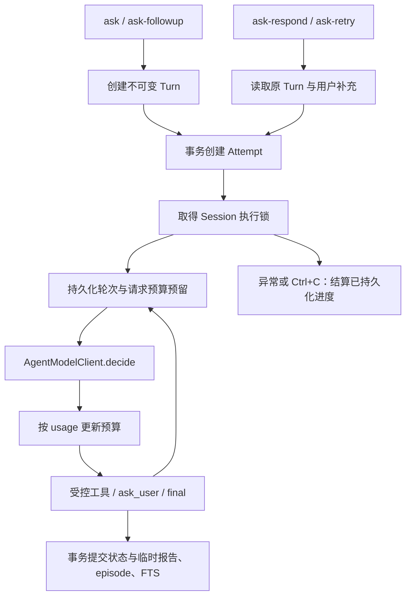

# 阶段 19D.1：交互 Agent 的可靠执行与恢复

后续修正：2026-10-08 的输入估算与预算压缩回归已修复，当前细节见 [首轮预算修复](24-agent-context-budget-fix.md)。本章验证结果保留为当日阶段记录。

## 1. 本阶段解决的问题

阶段 19C 已把分析、预算和证据定位到 Turn。本阶段收口工作区已有的 Attempt 与模型适配实现，并修复架构审计发现的提交一致性问题：数据库使用 autocommit，文件锁本身不能让多条 SQL 一起提交。

现在，失败或用户补充创建新 Attempt，继续同一 Turn 的目标、授权和预算；新问题使用 `ask-followup` 创建新 Turn。每个成功 Turn 保留自己的临时报告。正式 ResearchRun、评分、门闸与完成产物仍由固定流程管理。

## 2. 实际数据流



`ask_user` 结束当前 Attempt，Turn 为 `waiting_user`。`ask-respond` 用新 Attempt 接收补充。`failed`/`interrupted` 可重试；`succeeded` 和 `budget_exhausted` 不能重开。恢复不是继续旧 Python 栈，也不自动重放网络操作。

## 3. 文件与入口

- `agent_runtime.py`：合法 Turn 状态迁移；拒绝修改成功或预算耗尽的 Turn。
- `agent_model.py`：三参数 `AgentModelClient.decide(root, messages, model)`；生产调用包装和确定性 `ScriptedAgentModelClient`。ContextVar 在同步调用边界传递剩余预算，保持原函数测试接口兼容。
- `agent.py`：`ask/followup/respond/retry/interrupt`；`_start_attempt` 创建执行记录；`_record_attempt_progress` 持久化计数；`_execute_session` 处理执行锁、异常和中断；`_finish_attempt_and_turn` 原子结算。
- `storage.py`：`transaction` 使用 `BEGIN IMMEDIATE`，嵌套使用 SAVEPOINT；Session 执行锁与短时项目写锁分开；schema v12 显式迁移。
- `writer.py`：HTTP 请求增加可选 `max_tokens`，原 Writer 默认参数保持不变。
- `cli.py`：新增恢复入口与 `ask-interrupt`；业务 JSON 仍到 stdout，长任务进度仍到 stderr。

Session 保存会话汇总；Turn 保存累计预算；Attempt 保存本次执行的计数。事件、trace 和临时报告带 Turn/Attempt 标识。分析产物与引用回执仍以 Turn 隔离，具体执行可通过带 Attempt 的工具事件/trace 关联；没有新增通用事件重放层。

## 4. 最小可运行示例

项目根执行以下离线测试，无需 API Key 或 OpenD；fixture 均为虚构教学资料：

```sh
./.venv/bin/python -m pytest -q tests/test_stage19_runtime.py
```

`test_respond_reuses_waiting_turn_and_keeps_attempt_timeline` 展示“模型提问 → 用户补充 → 同一 Turn 完成”；`test_retry_reuses_successful_tool_and_user_responses` 展示失败重试与成功工具复用。实际离线 demo 也已运行：waiting_user → succeeded，同一 Turn 两个 Attempt，累计 2 轮、12 tokens。结果摘要在 `data/audits/20261007-runtime/offline-demo.json`。

真实 CLI 使用 UTF-8 JSON 文件，先将输入保存到 `data/`，再执行：

```json
{"question":"未来三年需要重点核对哪些事实？"}
```

```sh
./.venv/bin/wonder-research --root . ask HK.00700 --input data/question.json
./.venv/bin/wonder-research --root . ask-status SESSION_ID
./.venv/bin/wonder-research --root . ask-respond SESSION_ID TURN_ID --input data/response.json
./.venv/bin/wonder-research --root . ask-retry SESSION_ID TURN_ID
./.venv/bin/wonder-research --root . ask-interrupt SESSION_ID TURN_ID
```

`response.json` 也是 `{"question":"用户补充内容"}`。ID 使用前一次返回值；按状态选择命令，不依次盲目执行。实际调用模型需用户已配置的 DeepSeek 凭据；本阶段未运行真实 API。

Ctrl+C 会标记 interrupted。进程被强制杀死时可能遗留 running；先确认进程已退出，再执行 `ask-interrupt`。执行锁会拒绝中断仍持锁的进程。该命令只结算遗留状态，之后是否 retry 由用户决定。

## 5. 为什么这样实现

**事务保证数据一致。** 成功状态、临时报告、episode 和 FTS 投影一起提交；其中任意写入失败就回滚，再结算失败。Memo 主记录与长期记忆投影也一起提交。嵌套 SAVEPOINT 让通用记忆更新既可独立使用，也可参与外层事务。

**在调用前预留预算。** 发请求前先把剩余预算作为本次最坏预留持久化；成功返回或错误携带可信 usage 时，再替换为实际消耗。未知 usage、调用中硬崩溃或中断，保留预留而不按零消耗计算。此时 `used_tokens` 是保守的已占用预算，不能作为实际账单统计；retry 可能因额度不足而拒绝。API 输出上限由剩余预算减去字符估算输入得到，估算不是 tokenizer，也不能保证精确费用上限。

**复用有边界。** 同一 Attempt 重复工具/参数仍触发循环保护。同一 Turn 后续 Attempt 按工具名与规范化参数哈希复用已成功结果；失败调用可重新尝试。大结果只保存摘要与哈希，有分析产物 ID 时可以通过受控工具继续读取；普通截断结果不作为完整缓存复用。没有报告或来源内容的无条件跨 Turn 缓存。

**迁移不改历史正文。** v11 已加入 Attempt、按 Turn 临时报告及 Memo/trace/event 关联；v12 为没有 Attempt 的 legacy Turn 回填状态与历史计数，关联旧事件/trace 的 Turn 元数据。保留报告 JSON 和原研究记录；不伪造旧 Attempt。CompanyMemo 同时接受新 UUID Turn 和迁移 legacy ID。

## 6. 实际验证及其限度

2026-10-07 实际运行：

- `./.venv/bin/python -m pytest -q`：213 passed，2.41 秒。
- `./.venv/bin/ruff check src tests`：All checks passed。
- `./.venv/bin/wonder-research --root . ask-interrupt --help`：参数帮助正常。
- 合成 v9 → v12：历史报告 JSON、legacy 状态和 37 tokens/2 轮保留，重复初始化与外键检查通过。
- 注入 v11 → v12 迁移失败：DDL 与 user_version 一起回滚，随后正常迁移成功。
- 当前真实库只读备份到临时副本，v11 → v12 两次初始化通过；quick_check=ok、外键错误为 0。31 条 runs、427 条 sources、494 条 run_sources、268 条 run_steps、184 条 draft_sections、63 条 draft_reviews、22,713 条 source_conflicts 及 stocks/Memo 表保持逐行哈希不变；临时报告正文和 13 个冻结产物字节不变。主库文件哈希不变。摘要在 `data/audits/20261007-runtime/migration-rehearsal.json`，临时副本已由 TemporaryDirectory 清理。

故障回归覆盖报告/episode 写入失败、Attempt 创建回滚、Memo 投影回滚、FTS 更新回滚、Ctrl+C、未知用量、超额回答拒绝、响应恢复、同 Turn 成功工具复用、遗留中断、预算继承、不可变报告历史和 trace 关联。测试不能证明真实模型回答正确、网络服务可用或 SIGKILL 的全部时序；遗留运行状态通过显式 interrupt 测试模拟。

## 7. 小练习

把 scripted model 的第一次响应改为返回非法 `final`，保留其 7 tokens 用量，然后用 `retry` 返回合法 `final`。预期第一个 Attempt 为 failed，第二个 succeeded；同一 Turn 累计 14 tokens，而不是重新从 0 开始。将 token_budget 设为 256，模拟用量未知，则原预留保留，重试被预算限制拒绝。

## 8. 限制与下一步

本阶段没有迁移主库、重建 FTS、删历史、调用真实 DeepSeek/OpenD、安装框架或部署 CI。下一次正常业务初始化将执行 v12 迁移；真实运行前仍应保留数据库和冻结产物备份。当前锁使用已有 macOS/Linux 的 fcntl 实现；未验证 Windows。

记忆的中文检索、Turn 工作状态、增量同步、共享页级索引和备份覆盖仍按 [架构审计](22-memory-storage-architecture-review.md) 分阶段推进。19D.2 上手/面试案例与 19E 评测仍待决定；GitHub Actions 按最新用户要求暂缓。本阶段完成后暂停。
