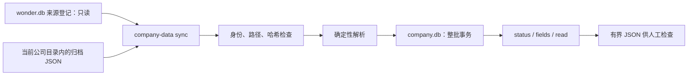

# 公司数据层 A：独立 SQLite、离线解析与增量回填

完成日期：2026-10-08。下文记录 A 阶段交付时状态；其后 Agent 已在 [B 阶段](29-company-agent-query.md) 接入共享查询及补取后索引。A 实现 [独立公司数据库计划](27-company-database-plan.md) 的离线投影，另提前补齐新库备份；A 没有接入 company_latest、联网刷新或执行 30 道真实问答。

## 1. 解决什么问题

原先公司资料主要保存在归档 JSON，SQL 查询每次临时解析。基本资料没有结构化字段表，经营效率、营收构成有内容却未被旧数值解析覆盖。

现在有独立的 `data/company.db`，所有公司按 ticker 共用。它从已登记原文生成查询投影，可以增量导入，也可以离线重建。`wonder.db` 的研究、会话和来源关系保持不变。当前 Agent 的 QueryWorkspace 仍沿用原路径，本阶段不声称 Agent 已能自动使用新库。

## 2. 实际数据流



源文件仍保存在原位置，不复制全文到公司库。此次来源是本项目已归档的 Futu 四类数据，不调用富途 SDK、OpenD 或 DeepSeek。未来新采集资料目前需要显式运行 sync，尚未自动索引。

## 3. 文件和调用路径

- [company_parser.py](../src/wonder_stockresearch/company_parser.py)：`parse_company_archive()` 只接收字节和数据集名。输出 Pydantic 基本字段、财务事实和诊断，无文件、网络或数据库操作。
- [company_data.py](../src/wonder_stockresearch/company_data.py)：`sync()` 取得项目写锁，只读来源登记，校验字节，事务保存批次；`status()`、`read()` 检查覆盖和原始字段；`backup_database()` 复制公司库快照。
- [cli.py](../src/wonder_stockresearch/cli.py)：增加 `company-data` 子命令，校验查询参数并输出最终 JSON。
- [research.py](../src/wonder_stockresearch/fixed/research.py)：原 backup 持锁期间额外备份 company.db；manifest/RESTORE 说明增加可选公司库项。
- [test_company_data.py](../tests/test_company_data.py)：虚构资料上的离线解析、事务、故障、路径和恢复测试。

公司库 schema v1 有三张业务表：

| 表 | 作用 |
| --- | --- |
| source_batches | source_id、哈希、ticker/dataset、来源快照、解析器版本、导入时间、状态、事实数量与诊断 |
| company_profile_facts | 基本资料原始字段键/名称、JSON 值和类型、生效时间（若原文提供）、定位 |
| financial_facts | 原始科目键/名称、原始数值文本、Decimal 文本、期间、币种/单位/倍率、会计范围/准则、维度与定位 |

定位精确到值，如 `$.payload.statements["1"].report_list[0].item_list[0].data`。statement_type+field_id+attribute 组成科目键，避免利润表和资产负债表共用 field_id 时混淆。data/yoy/qoq 分别保存；关键指标的分组标题也放入 dimensions，保留“盈利能力TTM”等来源信息。

经营效率解析各实际数值字段；营收构成保留业务/产品/地区类别和具体分部。最新构成在 historical_breakdowns 中完全重复时只解析一份，数值不同则保留冲突及各自定位。跨来源的获取事件及版本不合并。

## 4. 可以运行的命令

在项目根执行，参数无需模型或 OpenD：

```bash
uv run wonder-research --root . company-data sync
uv run wonder-research --root . company-data sync HK.00941
uv run wonder-research --root . company-data status
uv run wonder-research --root . company-data fields HK.00941 --dataset statements --limit 10
uv run wonder-research --root . company-data read HK.00941 --dataset profile --field 公司名称 --limit 1
uv run wonder-research --root . company-data read HK.00941 --dataset statements --field 营业总收入 --period 2025/FY --limit 10
```

`read`/`fields` 支持 dataset、原始字段键或精确名称、period、source_id、limit 和 offset。limit 每表默认 50、最大 200，返回 has_more；参数全部绑定 SQL，不提供任意 SQL 执行入口。

**当前选择语义为 all_indexed_sources**：显示所有已索引来源版本，不代表去重后的最新事实，也不代表当时已知的历史版本。输出有 source_id/哈希/原始路径/定位。相同年度的多个版本不能直接一起 AVG；下一阶段在明确数据选择后导出 Agent 快照。

完整重建命令：

```bash
uv run wonder-research --root . company-data rebuild
```

它在 data 下生成临时数据库，导入全部四类来源并检查 SQLite 完整性；有 failed 批次则保留原库，清理临时文件；成功后关闭连接再原子替换 company.db。重建会仅保留当前解析器生成的投影，旧解析器投影可由对应程序和归档重建；旧研究/计算文件不变。重建不能限定一个 ticker，以免误删其他公司。

现有备份命令仍可用：

```bash
uv run wonder-research --root . backup --output data/backups/company-data-example
```

若公司库存在，同一项目写锁内分别生成 wonder.db/company.db 快照，manifest 的 company_database 记录公司库哈希/schema/解析器版本；恢复时复制两库并按 manifest 还原来源与既定报告文件。没有公司库的旧项目保持兼容。本阶段没有扩大原备份的计算产物收录范围，也没有执行主项目完整恢复；恢复测试使用虚构离线资料。

本次实际执行了 Python CLI 的 sync，以及 `.venv/bin/wonder-research` 的 fields/read；真实数据上没有执行重建或完整项目备份。

## 5. 为什么这样实现

**普通函数与 Pydantic。** 解析是可独立测试的纯函数，存储服务负责文件和 SQL，不增加 ORM 或接口抽象。新衍生问题不需要新增专门数据库表或问答函数。

**数值存 TEXT。** 用 `json.loads(parse_float=Decimal)` 避免先转二进制浮点，再把 Decimal 文本保存到 SQLite；负值和零保留，NaN/Infinity/bool/损坏文本不作为事实。实际运算仍需明确单位并在受控计算层执行，不直接把 TEXT 当作已规范的统一金额。

**不猜元数据。** 报表日期保留来源记录的日期，不按 FY 标签补成 12 月 31 日；起始日期、披露时间、基本资料生效时间、单位和倍率缺失时保持 null。available_from 可能只是旧采集器推导的期末，不当作披露时间。关键指标混有百分数、倍数、每股数，不统一继承报告的币种；分组的原报告币种另留在维度中。百分号原文可明确标为 %；未提供单位的值不凭指标名称猜倍率。

**每来源一个事务。** 主键是来源+哈希+解析器版本；基本字段/数值和批次状态一起提交。重复 sync 仍检查原文哈希，但跳过已成功且身份不变的解析。崩溃回滚整个批次，重跑自然补齐。解析器版本升级新增批次，不用 ticker+年份+指标覆盖旧版本。

**完整、部分、失败分开。** 已知空列表允许零事实；未知结构或哈希错误记 failed，并从人工事实读取中排除；原文缺值/无法转数值/旧采集失败记诊断，其他有效值可保留为 partial。status 返回分组覆盖与最多 50 个异常批次诊断。sync 处理的 partial 数量不是全部历史异常数；查看完整当前覆盖应使用 status。

增量导入可以保留其他成功批次并以非零退出码报告 failed；重建有任何 failed 都不激活临时库。原始证据从不删除或修改。公司数据库及归档路径拒绝越界/危险符号链接，避免重建误替换主库。

## 6. 实际验证

2026-10-08 的结果：

- `./.venv/bin/python -m pytest -q`：246 passed（3.26 秒）；其中本阶段 20 个用例。
- `./.venv/bin/ruff check src tests`：All checks passed；`git diff --check` 无错误。
- 来源和主库只读副本位于忽略的 `data/audits/20261008-company-db/baseline-root/`；它仅覆盖本阶段四类原文及主库快照，不是完整项目备份。
- 隔离导入 92 个历史来源，第二次全部跳过；510 条基本字段和 98,377 条数值全部逐条回到原始 JSON 定位核对值。
- 实际本地库回填同为 92 个来源、510/98,377 条事实，第二次全部跳过。company.db 为 47,652,864 字节，约 45.45 MiB；这是含历史版本、同比等属性的投影规模，不是存储优化成绩。
- 七家公司最新经营效率和营收构成的 14 个来源，现在在公司库中均有 14–400 条数值事实；旧 QueryWorkspace 解析器尚未切换。
- 一份旧中国电信营收构成归档有九个历史期间获取失败，保留 partial 和各期间诊断；其余 91 批次 completed，没有 failed。
- 回填前后 wonder.db SHA-256 相同，正式研究/会话/来源登记未修改。此轮无模型/OpenD/账户访问、无真实 30 题执行、无 Git 提交。

审计摘要分别为 `isolated-validation.json`、`value-validation.json`、`local-backfill.json`，保存在上述 audit 目录。

离线测试覆盖 Decimal 精度/零负值/非数值、字段补名、财年日期/TTM 分组、基本资料、经营/分部解析、重复/冲突、跨来源历史版本、路径/哈希/身份、批次回滚、损坏恢复、重建失败保留原库、解析器升级、CLI 校验、主库不变和双库备份恢复。这些检查不证明富途原数值或会计口径本身正确，也不证明 Agent 已会选择正确数据。

## 7. 小练习

在测试 `test_efficiency_numeric_fields_not_metadata_or_invented_units` 的虚构 item 中增加一个自定义数值字段。预期解析器保留原始键和值，不需要添加公式；将它换成 `"--"` 后应出现诊断，不产生零值。不要改真实归档来做这个练习。

## 8. 限制和下一阶段

当前仅支持项目已有 Futu envelope 的四类资料；字段键保留原始供应商语义，尚未建立跨供应商科目映射。很多单位、披露日期仍未知；历史时点和重述版本不能靠建库自动补全。保留来源获取事件会重复存储相同经济数值，后续按测量决定是否共享相同内容的解析投影。

下一阶段 B 实现显式公司数据范围、字段目录与覆盖供 Agent 查询、profile 按需补取、补取后增量索引、跨 Turn 复用和本 Turn 证据回执，并继续核验备份涉及的计算引用。正式 run 的来源范围和冻结规则继续保持。然后用 30 题评测计算、引用、期间和成本。

本阶段完成后暂停。
