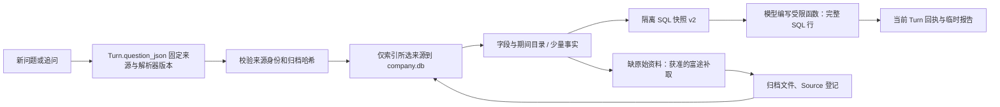

# 公司数据层 B：固定来源范围、共享查询与按需刷新

完成日期：2026-10-08。承接 [A 阶段](28-company-data-store.md)，本阶段把公司投影接入独立 Python Agent；[30 题评测](26-company-data-and-agent-eval.md) 仍是下一阶段。

## 1. 解决什么问题

原 Agent 主要按 run 读取归档，其他 Turn 补取的公司资料无法自然复用；每次临时解析也未覆盖全部基本资料、经营效率与营收构成。现在新增显式 `context=company_latest`，从已登记资料为每类公司数据选择一个来源版本，再使用 company.db 查询投影。

新 `chat` 临时问题使用此范围。直接 `ask` 的 JSON 默认仍是 `latest_completed_report`，原上下文不改义；需要共享公司资料时显式选择新范围。正式研究继续自己的来源集合。company_latest 不等于严格历史 as_of 查询，也不保证供应商覆盖所有指标。

## 2. 实际数据流



来源授权保存在 wonder.db，事实投影保存在 company.db，计算在 data/tmp/analysis 的独立快照上执行。模型不能直接连接任一业务数据库。

## 3. 文件与调用路径

- `agent_company.py`：`freeze()` 选取四类 Futu 资料各一个最新获取版本（时间相同时以来源 ID 稳定排序），保存完整 Source 和解析器版本；`scope()` 验证 Turn 身份；`context_sources()` 区分当前查询版本与仍可引用的旧输入；`facts()` 校验原文、按所选来源增量索引，查询精确批次；`query()` 返回目录、期间、覆盖和有界事实。
- `agent.py`：创建 Turn 时固定内部 `_company_scope`，重试不重选；追问重新选择资料并继承 `allow_network`。公司范围只优先展示四类来源、可信长期记忆，避免 provisional 旧答案成为数据依据。最终引用和 Memo 校验仍需本 Turn 回执及未变的归档。
- `company_data.sync(source_ids=...)`：Agent 只检查选中来源；人工 CLI 仍可同步全部历史。无需主库 schema 迁移，仍为 12；公司库仍为 1。
- `agent_tools.py` / `tool_registry.py`：新增 `query_company_data`；默认 fields 返回实际字段及可用期间，不能引用。facts 模式保留值与 locator，并附紧凑字段导航。目录同时给出可直接查询的 SQL 列，减少额外发现调用。
- `agent_data.py`：补取支持 profile、statements、operational_efficiency、revenue_breakdown；补全归档 envelope 的 provider/dataset，登记 Source 后增量索引。当前 Turn 同一数据集复用已补取来源；离线模式在连接供应商前拒绝。
- `query_workspace.py`：公司范围使用快照 v2，增加 company_profile_facts、原始 field_key、期间类型、单位/倍率、会计口径、业务维度与来源/解析版本。旧范围继续快照 v1。基本资料也可通过 fact_id 建立来源引用。
- `agent_context.py` / `agent_memory.py` / `agent_model.py`：完整结果与聊天预览分开。省略记录不代表缺失；可见 SQL 引用随可见行对齐，函数仍读完整 SQL 结果。默认单次输入目标 5,000，按固定规则及最新有界结果扩大至最多 8,000；总预算仍为新 Turn 默认 30,000，实际按 API usage 结算，重试不刷新。
- `research.backup()`：同一写锁下备份两库、来源、完成报告及已登记计算的快照/SQL/函数/结果。按数据库快照中的执行状态选择文件，记录 missing/incomplete_analyses，校验复制前后哈希；符号链接越界和文件变化报错。

当前四类资料各选一个最新获取事件，而不是逐科目合并多份历史。某个最新批次失败时返回 failed，不偷偷退回旧数值。partial 的有效事实仍可查询，同时保留诊断。来源模型没有通用撤回状态，本阶段没有假装已实现这一机制。

补取会替换当前查询的数据集版本，但原固定来源和已返回输入仍在引用授权中；新 SQL 用新快照，旧 analysis_id 保持原输入。其他 Turn 的补取只能通过新 company_latest Turn 显式纳入，旧 run 范围不会因此扩权。

工具注册表版本变为 5，analysis-workspace Skill 变为 5。固化旧工具/Skill 版本的会话可能拒绝恢复并要求新建问题；不能默默升级其授权。历史来源和计算文件保留，未写入版本授权的旧范围继续原工具集合。

## 4. 最小示例与实际命令

先创建项目 data 下的 UTF-8 问题文件，例如 `data/inputs/company-question.json`：

```json
{
  "question": "中国移动最近三年毛利率平均值",
  "context": "company_latest",
  "allow_network": false
}
```

```bash
uv run wonder-research --root . ask HK.00941 --input data/inputs/company-question.json
uv run wonder-research --root . chat --text "中国移动最近三年毛利率平均值"
uv run wonder-research --root . company-data status HK.00941
uv run wonder-research --root . backup --output data/backups/manual-company-backup
```

`ask` 需要已配置模型凭据；上例 `allow_network=false` 只禁止资料补取，模型调用仍联网。`chat` 新问题默认允许资料补取，需已配置 OpenD。日志写 stderr，最终 JSON 写 stdout。不要把凭据写入输入文件。

工具选择的普通过程：fields 查实际字段/期间 → SELECT 选择同一 field_key、期间类型和口径并保留 fact_id → 受限函数计算 → 引用当前 Turn 返回的定位。SQL 结果可以有更多行；聊天只展示部分时，函数依然收到完整行，避免为了看全预览重复查询。

已实际运行的隔离真实模型验证和诊断保存在忽略的 `data/audits/20261008-company-agent/`。没有把真实财务资料或运行数据库提交 Git。

## 5. 为什么这样实现

SourcePin/CompanyScope 用 Pydantic 验证，存在现成 Turn JSON 中，无需新增授权表或框架。来源哈希、解析器版本与每个计算快照共同防止重试时换数据。跨库没有外键，身份检查由普通函数完成；只让 company.db 做可重建查询层。

字段来自实际来源，不新增“某公司三年平均”专用工具。data/yoy/qoq、年度/中期和业务分部属于输入语义，必须先筛选；平均、增长率等由模型选择 SQL 或受限 Python 表达。未知单位不根据字段名硬填。

本轮参考 Dexter 的受控工具/Skill 注册与调用轨迹、Pi 的运行记录到模型上下文转换边界；来源固定、公司投影和两库备份是本项目实现，不归因于上游框架。没有引入 TypeScript、外部 Agent 宿主或多 Agent。

## 6. 实际验证与不能证明的事情

离线用例覆盖四类资料、跨会话复用、同 Turn 来源固定、追问重新选取及离线权限继承、profile 补取与幂等索引、失败/部分覆盖、原文/身份/ticker 损坏拒绝、目录不可引用、本 Turn 回执、来源替换后的旧输入引用、SQL/函数完整行和双库/计算产物恢复。还用真实 Skill 的固定开销复现“三条结果被压成一条”，验证可见输入及累计收费。

中国移动真实归档隔离查询：四类来源各一个，6,388 条数值、23 条基本字段，第一次 schema + SQL 查询约 0.36 秒；主项目 wonder.db 哈希未变。

同一原问题在开发中的六版实现上各调用了一次真实模型；前五次虽 status=completed，却存在误判缺失、反复查询、未执行计算或猜平均等质量失败，均保留诊断，不能算通过率。最终实现一次运行走 query_company_data → run_readonly_sql → run_analysis_function → final，4 次决策、14,252 tokens、约 5.78 秒；三条输入为 2025/FY 58.227439、2024/FY 58.436007、2023/FY 59.209519，函数原始均值 58.6243216667，数值及三个原文定位核对一致。这是开发冒烟验证，不是多次稳定性或完整 30 题成绩。

**仍不能把该答案判为完整合格：归档 unit/scale 缺失，模型仍输出百分号，对具体财年/口径也留下缺口。** 程序验证来源授权和定位，不证明模型每句话与输入相符。后续评测必须把数值计算正确、单位/期间表述和引用支持程度分开，不能以 status=completed 替代质量验收。未调用真实富途刷新接口，补取路径目前由离线假供应商验证；没有运行完整主项目恢复。

离线全量测试和静态检查的最终命令及结果见 PROGRESS。

## 7. 小练习

给虚构 statements fixture 增加一个同比值，与原值使用相同中文名称。用 fields 查看它们的 field_key，再分别取 data 与 yoy：应得到不同输入，不应混算。再把原始文件改动一个字节，旧 Turn 查询和最终引用应明确报哈希错误，不能偷偷换成另一个来源。

## 8. 限制与下一阶段

company_latest 指最新登记版本，缺少按资料类型的自动新鲜度策略；不会定时抓取或自动回填用户未请求的数据。原始单位、披露时间和重述版本无法由建库补造；旧解析版本批次缺失时旧 Turn 查询拒绝改用新解析器，需恢复对应备份。投影体积、FTS 重复和中文检索留待测量后处理。

下一阶段 C：保留版本快照，执行既有 30 题；单独评分输入期间/口径、计算产物、引用支持、预算与失败类型。优先收口本次已经出现的单位臆断、未计算却宣称平均值、查询重复和目录截断误判。性能/体积和模块职责的进一步简化放在 D。按教学约定本阶段完成后暂停。
