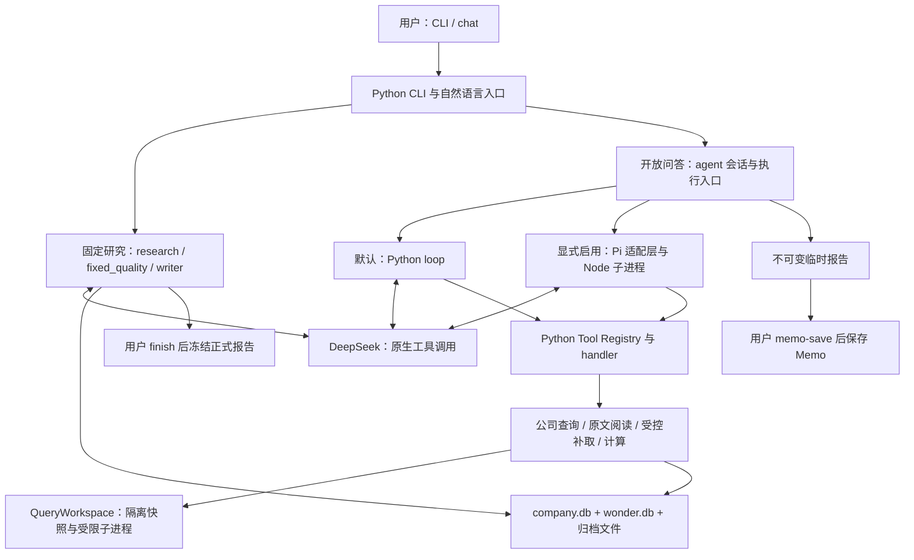
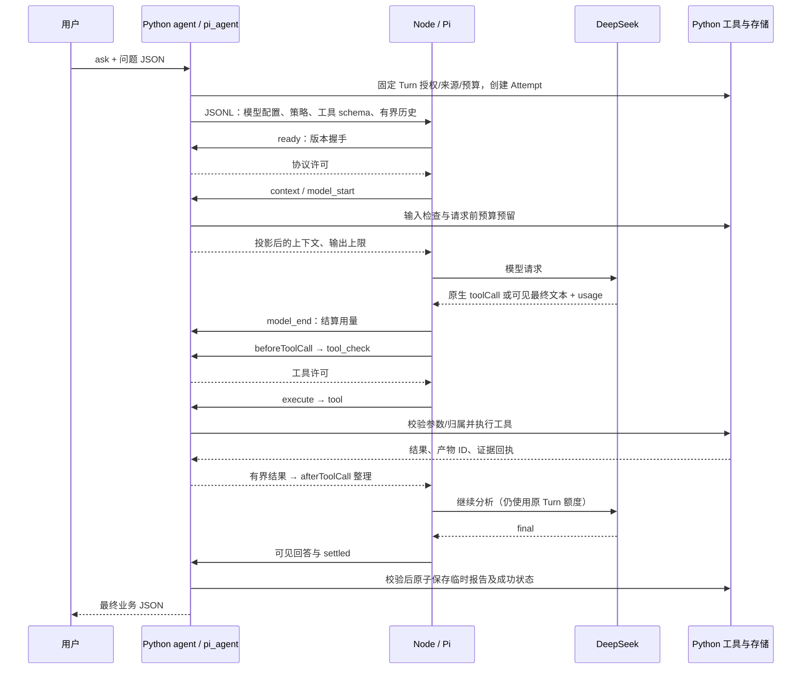

# 当前项目架构：Python 研究核心、公司数据层与 Pi 问答运行时

2026-10-10 更新：执行规则已拆为两种运行时共用的 Python 操作，新增严格版本协议与 Pi 工具前后钩子；本章调用链已同步。完整代码阅读与验证见 [执行架构说明](35-agent-execution-architecture.md)。

核对日期：2026-10-09。本文根据当前工作区源码与实际离线测试整理，作为架构阅读入口；早期章节用于理解演进过程，当前实现以本文注明的代码入口和边界为准。

## 1. 先理解现在的整体结构

项目现在是一套本地公司研究程序：**Python 管理研究规则、数据、证据和保存；开放问答可以选择项目内的 Node/Pi 运行时；固定研究继续由 Python 流水线执行。** 用户从同一个 `wonder-research` CLI 进入，两条业务路径共用来源与领域服务。

这里需要区分“已实现”和“默认启用”：

| 部分 | 当前实际状态 |
| --- | --- |
| 固定公司研究 | Python：采集 → 证据包/可信计算 → 分组写作 → 审查/校验 → 用户定稿 |
| 开放问答默认路径 | 既有 Python Agent loop，仍然保留 |
| 开放问答 Pi 路径 | 已实现的预览，通过 `WONDER_AGENT_RUNTIME=pi` 显式选择；尚未通过真实质量验收 |
| 自然语言 Router | Python 调用 DeepSeek，返回经校验的 `RoutePlan` |
| 公司共享数据 | 独立 `data/company.db`，从已归档资料解析而来 |
| 研究、会话与来源登记 | `data/wonder.db`，代码支持 schema v13 |

schema v13 是代码支持的版本，不能据此认定任意用户现有数据库已经迁移。本文没有对主库执行初始化或迁移。



图中的 Router、Writer、Reviewer 是受控分类、写作和审查组件，不是额外的自主 Agent。当前只有一个开放问答 Agent；两种运行时是同一业务能力的可选执行路径。

## 2. 相比早期架构，哪些地方变了

### 2.1 从全部 Python 循环，变成可选的 Python + Pi 分工

早期由 Python 发出模型请求、解析 JSON 决策、调用工具，再继续循环。现在新增 Pi 路径，把通用的模型协议、SSE 流、原生工具调用和循环调度交给锁定的 SDK：

- `@earendil-works/pi-ai`：0.83.0。
- `@earendil-works/pi-agent-core`：0.83.0。
- 运行要求：Node >=22.19，依赖安装在项目自己的 `pi_runtime/` 中。

实际运行文件是构建后的 JavaScript `runner.mjs`；2026-10-10 起源码为 [runner.ts](../src/wonder_stockresearch/pi_runtime/src/runner.ts)，SDK 钩子/消息接受 TypeScript 检查，Python 业务核心不改语言。项目没有引入 `pi-coding-agent` 的 shell/文件工具、Pi CLI、全局会话目录或外部宿主配置。参考项目不属于运行依赖。

Python 继续拥有业务决定权：模型可以提出调用，但能否调用、读取哪家公司、采用哪些来源、是否超过预算，以及能否保存回答，都由 Python 判断。具体代码见 [agent.py](../src/wonder_stockresearch/agent.py)、[pi_agent.py](../src/wonder_stockresearch/interactive/pi/pi_agent.py) 和 [runner.mjs](../src/wonder_stockresearch/pi_runtime/runner.mjs)。

### 2.2 从按问答临时解析，变成可复用的公司事实投影

原文仍留在股票目录中；新增 `company.db`，把四类富途归档转换为可查询字段和数值：`profile`、`statements`、`operational_efficiency`、`revenue_breakdown`。

新问题可以复用已经登记的公司资料，但必须先固定本 Turn 的来源和解析版本。公司库提高资料复用程度；其内容仍需回到原文定位，不能因入库就被认定为已核实结论。

### 2.3 从单个 session 结果，变成 Session / Turn / Attempt

会话、用户目标和执行尝试已经分开保存。追问创建新 Turn；失败重试创建新 Attempt，继续消耗原 Turn 的额度。成功回答按 Turn 保留，避免后一次执行覆盖前一次结果。

### 2.4 执行记录与模型上下文分开

来源原文、SQL 完整结果、可见调用记录和模型本轮看到的摘要是不同对象。模型只接收有界投影与工作记录，需要更多内容时按页查询或读取产物。压缩聊天上下文不会删除对应的来源或计算文件。

这些变化各自解决资料复用、执行恢复和请求容量的问题；Pi 接入本身没有改变公司研究方法或正式报告冻结规则。

## 3. 两条业务路径怎么走

### 3.1 固定研究：生成可归档的公司报告

```text
start_run
  → collect / source_add
  → build_evidence_packs + calculate_trusted_metrics
  → write_draft（默认 staged）
  → 分组答案 + 门闸/评分/反证综合 + DraftReview + 必要的定向修订
  → validate_run
  → 用户明确 finish
  → finish_run：渲染、保存产物、记录哈希与 completed
```

[research.py](../src/wonder_stockresearch/fixed/research.py) 管理 run、来源关联、校验和定稿；[fixed_quality.py](../src/wonder_stockresearch/fixed/fixed_quality.py) 构造六组证据包及 Decimal 可信计算；[writer.py](../src/wonder_stockresearch/fixed/writer.py) 调用 DeepSeek 分组写作和审查；[reports.py](../src/wonder_stockresearch/fixed/reports.py) 根据结构化数据渲染 Markdown。

固定流程覆盖 Q01–Q24、六项公司门闸和 M1–M6。单项评分及理由来自待验证判断，总分由 Python 计算。价格和估值不能改变公司分数，Q25–Q28/G4 仍未实现。

`draft_sections` 保存分组结果和输入哈希，相同输入可复用已成功分组；`draft_reviews` 保存与草稿哈希对应的审查。新 standard run 定稿需要匹配当前草稿的 passing review，修改草稿会使旧审查失效。模型审查和 Python 校验作用不同，二者都不构成结论正确的保证。

正式产物包括 `company.md`、`research.json`、适用时的 `quality-review.json`，有复评基准时还包括 `review.md`。`finish_run()` 先校验并写入文件，再事务提交完成状态与哈希；重复定稿核验既有产物，不覆盖完成报告。文件与 SQLite 之间没有一个共同事务，失败恢复依赖这个写入顺序和幂等检查。

`chat` 进入固定研究时有两处用户确认：启动研究之前，以及 `validate` 通过后执行 `finish` 之前。开放问答工具没有 `finish` 权限。

### 3.2 开放问答：回答一个具体问题

```text
ask / chat 的 interactive_question 分支
  → 校验问题、选择资料范围与 Skill 工具集合
  → 创建 Session / Turn / Attempt
  → 默认 Python loop，或显式选择 Pi
  → 查询/阅读/补取/计算，可多轮执行
  → 校验 final 的结构、来源范围和所需证据回执
  → 保存该 Turn 的 InteractiveReport
  → 用户需要长期保留时另行 memo-save
```

例如“查询某公司三个完整财年的同一指标并计算平均值”，合理路径是先取得实际字段和期间目录，再选择一致口径的事实，最后执行计算并引用输入。工具顺序由模型在授权范围内选择，没有为每一道问题写固定流程。当前实现也尚不能保证模型每次都完成必要检索和计算。

三种产物的意义不同：

| 产物 | 保存位置与触发 | 对正式评分的影响 |
| --- | --- | --- |
| 正式公司研究 | `runs` + 股票 run 目录；用户 `finish` | 正式研究判断与评分所在版本，完成后冻结 |
| 临时回答 | `interactive_reports`；成功 Turn 保存 | 不修改正式报告、门闸或评分 |
| 公司 Memo | `company_memos`；用户明确 `memo-save` | 保留来源和版本，默认不参与正式评分 |

Memo 是用户选定的长期观察，不等同于尚未实现的正式研究“附记”。要把交互结果纳入正式研究，仍须新建固定 run 并重新校验。

## 4. Python 与 Node/Pi 如何协作

### 4.1 每层的职责

| 文件或组件 | 负责什么 |
| --- | --- |
| `cli.py` | argparse 参数、UTF-8 JSON 输入、输出和错误展示 |
| `agent.py` | 公开会话与 Memo 入口、授权快照、选择 Turn 冻结的运行时 |
| `agent_session.py` / `agent_execution.py` | 共用生命周期、预算、工具执行、引用与最终报告事务 |
| `legacy_agent.py` | 旧 JSON 决策与上下文适配，调用共用业务操作 |
| `pi_agent.py` / `pi_attempt.py` | 运行准备与命名事件适配，调用共用业务操作 |
| `pi_protocol.py` / `pi_bridge.py` | 版本/请求/回复校验、Node 进程通信、消息大小/空闲超时与清理 |
| `pi_runtime/src/runner.ts` → `runner.mjs` | 类型检查后构建；创建 Pi Agent、调用 DeepSeek provider、调度顺序工具并回传可见事件 |
| `pi_context.py` | 完整工具调用组、有界结果投影、上下文选择及当前 Turn 工作记录 |
| `pi_evidence.py` | 从当前 Turn 回执生成短引用 ID，展开引用并构造修复反馈 |
| `tool_contracts.py` / `agent_results.py` | 共用工具参数、内部成功/错误结果与有界模型视图 |
| `model_request.py` | Writer、Router、公司识别与旧问答的公共 Python 模型请求 |

Pi 的一次 turn 通常包含一次模型调用及其工具批次；项目的 `AgentTurn` 是一个用户目标，可以包含多次模型调用。预算和报告归属使用项目 Turn，不能按 SDK turn 重新计费或重新授权。

### 4.2 一次 Pi 工具调用的来回



JSONL 是进程之间逐行传输 JSON 的协议，不是新的对外服务。Node 的协议 stdout 由 Python 读取，用户 CLI 的 stdout 仍保留最终业务结果；长任务进度写 stderr。部分终端命令如 `finish` 有人类可读展示，管道输出维持 JSON。

当前 `runner.mjs` 不实现研究数据库或报告文件读写，研究工具由 Python 执行。这里是受信任程序内部的职责分工，Node 子进程本身不是操作系统沙箱。模型请求凭据由环境提供，不经 JSONL 传输、不落库；隐藏推理也不进入消息记录。

最终结构/引用错误最多有一次定向修复。该轮撤掉模型可见工具，Python 同时拒绝工具调用，防止为修正引用重新执行整项研究；修复仍占用原预算。

## 5. 三处数据存储分别保存什么

```text
data/
├── wonder.db                         # 研究、来源身份、会话、回执、审计
├── company.db                        # 公司字段/数值的可重建投影
├── stocks/<ticker>/
│   ├── sources/<sha256>.<ext>         # 固定研究归档原文
│   ├── sources/<sha256>.txt           # 提取文本（适用时）
│   ├── agent-sources/<session>/<turn>/ # 按需补取原文
│   └── runs/<UTC时间>-<run_id>/        # 完成研究的冻结产物
├── tmp/analysis/<session>/<turn>/<analysis>/
│                                      # SQL 快照、查询、函数和完整结果
└── backups/<name>/                    # 用户显式创建的备份
```

### 5.1 wonder.db：业务状态和来源身份

主要表按用途分组：

| 用途 | 主要表 |
| --- | --- |
| 固定研究 | `stocks`、`runs`、`sources`、`run_sources`、`run_steps`、`draft_sections`、`draft_reviews`、`source_conflicts` |
| 开放问答执行 | `agent_sessions`、`agent_turns`、`agent_attempts`、`agent_events`、`agent_messages`、`interactive_reports` |
| 引用与分析 | `agent_evidence_receipts`、`analysis_runs` |
| 自然语言入口 | `chat_sessions` |
| 记忆与检索 | `company_memos`、`agent_scratchpads`、`memory_entries`/FTS、`source_page_fts` |
| 可观测性 | `traces`、`trace_spans` |

`runs.draft_json` 是草稿内容，Markdown 是渲染视图；手改 Markdown 不会回写研究判断。原始字节保存在文件中，以来源 ID、路径和 SHA-256 与数据库相连。

### 5.2 company.db：共享公司资料，不保存研究结论

[company_parser.py](../src/wonder_stockresearch/company_parser.py) 确定性解析归档；[company_data.py](../src/wonder_stockresearch/company_data.py) 校验来源、同步批次并提供查询。公司库当前 schema v1，包含三张表：

- `source_batches`：来源 ID、原文哈希、解析器版本、批次状态及诊断。
- `company_profile_facts`：公司名称等原始基本字段及 locator。
- `financial_facts`：原始字段、Decimal 文本、期间、币种、单位/倍率、会计口径、业务维度及 locator。

批次按来源/哈希/解析器版本幂等导入，整批事务避免半份资料。失败批次不作为事实返回，partial 保留有效数据及诊断。未知单位、披露时间不会因解析自动补齐。

公司服务只读主库取得来源身份，再写独立公司库；两库没有跨库外键或共同事务。顺序是先归档并登记 Source，再导入事实；失败后可以重新索引。公司库能从归档重建，原文和来源登记仍须保留。

### 5.3 QueryWorkspace：本次计算使用的隔离输入

模型生成 SQL 时，[query_workspace.py](../src/wonder_stockresearch/interactive/query_workspace.py) 先从当前 Turn 获准资料生成最小 SQLite 快照。SQL 只在该快照上执行，不连接 `wonder.db` 或 `company.db`。

公司范围快照包含 `financial_facts`、`company_profile_facts` 和最小 `source_metadata`；旧范围保留兼容快照。每个分析 ID 保留输入版本、查询、结果与哈希。后续补取产生新的计算输入，不改旧分析产物。

## 6. 资料范围、Skill 与证据如何限制模型

### 6.1 company_latest 的“最新”只在选取时生效

新 `chat` 的临时问题采用 `context=company_latest`；直接 `ask` 的默认仍为 `latest_completed_report`，需要共享公司资料时在问题 JSON 中显式选择。

[agent_company.freeze()](../src/wonder_stockresearch/interactive/agent_company.py) 从当前公司已登记来源中，为四类富途数据各选最新获取版本，并固定 Source 与解析器版本；有关联 run 时也保留范围内的其他材料。重试使用原快照，追问创建新 Turn 后重新选择。

获准的 `fetch_financial_data` 只能补取当前公司的四类资料。新来源写入 `agent-sources` 并登记到主库，公司范围查询会索引它；不会自动挂入正式 `run_sources`。补取可以更新本 Turn 的活动查询版本，已使用的旧输入仍可追溯。

`company_latest` 表示最新登记资料，不是严格历史 `as_of` 数据库，也不保证每一科目都完整。人工 `company-data read/fields` 查询的语义是 `all_indexed_sources`，不能把它当成已自动去重的最新事实。

### 6.2 Skill 提供方法和工具选择，Python 才授予权限

```text
skills/*/SKILL.md + 可选 skill.json
  → skill_registry.catalog：名称、描述、能力和版本摘要
  → Router：仅用摘要选择 RoutePlan
  → 执行边界按需加载正文/reference
  → capability + Skill manifest 解析工具 allowlist
  → Tool Registry 提供 schema，handler 再检查同一 allowlist
```

[capabilities.py](../src/wonder_stockresearch/capabilities.py) 定义受控能力；[skill_registry.py](../src/wonder_stockresearch/skill_registry.py) 加载 Skill；[tool_registry.py](../src/wonder_stockresearch/interactive/tool_registry.py) 登记稳定工具 ID/Pydantic 参数；[agent_tools.py](../src/wonder_stockresearch/interactive/agent_tools.py) 执行并检查公司、run、来源与产物归属。

当前 Tool Registry 为 v6。新增 Skill 可以组合已有工具，新增工具必须先有 Python 实现和注册。编辑 Skill 不能创建任意 shell/网络权限。授权版本和内容哈希会记录，恢复时发现不一致可要求新建问题，不默默升级旧授权。直接 `ask` 仍保留兼容工具集合，不能假定它和所有 `chat` Skill 暴露相同工具。

### 6.3 引用必须能回到本次实际取得的证据

字段/期间目录用于导航，不能作为事实引用。SQL 直接返回 `fact_id` 时，程序才可反查具体 `source_id + locator`；只返回聚合值的 SQL 不能凭空取得原始事实的引用资格。

新版分析路径以及公司范围最终引用还需满足当前 Turn 的实际证据回执和来源哈希检查。Pi 使用的 `ref_id` 只是短写法，展开后仍接受原引用校验，不扩大资料范围。

回执证明的是程序取得过这项证据及其定位，不能证明模型每句话都被证据支持。期间配错、单位臆断和错误文字解释仍需研究质量验收。

固定研究另有 `as_of` 可用性、权威来源支持和关键冲突门闸，由 `research.py` 与 [source_policy.py](../src/wonder_stockresearch/source_policy.py) 处理。取得资料的效率顺序与证据权威性是两套规则：优先查询结构化数据不代表其权威性高于官方披露。公司共享查询不会自动替代正式 run 的时间边界与来源集合。

### 6.4 计算能力有明确资源和语法限制

| 边界 | 当前限制 |
| --- | --- |
| SQL 输入 | 单条 `SELECT` / `WITH … SELECT`，最长 12,000 字符 |
| 快照/结果 | 最多 10,000 条输入事实、400 行 SQL 结果 |
| Turn 次数 | 最多 6 次 SQL 尝试、3 次函数执行 |
| 子进程资源 | 10 秒、256 MB、64 KB 输出 |
| SQL 权限 | immutable 只读连接、authorizer、query_only 与进度中止；拒绝写入/DDL/ATTACH/PRAGMA 等 |
| Python 函数 | 受限 `def analyze(rows)`，仅处理已保存 SQL 行；AST 检查，禁止 import、任意文件/网络/环境变量/shell 等 |

函数收到完整 SQL 结果，模型聊天中看到的几行预览不决定实际计算样本数。计算产物附实际字段/期间/单位覆盖摘要和函数哈希；经济口径仍需要模型正确选择并解释。固定可信计算器提供部分现成公式，其他指标可以通过上述 SQL/受限函数计算。

## 7. 恢复、预算、记忆与 trace

### 7.1 Session / Turn / Attempt 与 chat session

| 对象 | 含义 | 典型操作 |
| --- | --- | --- |
| `chat_session` | 自然语言路由、消歧、确认和入口恢复 | `chat --session-id` |
| `AgentSession` | 某公司的长期交互容器 | `ask` 建立，后续追问关联 |
| `AgentTurn` | 一次用户目标与授权/来源/预算快照 | `ask`、`ask-followup` 创建 |
| `AgentAttempt` | 执行或重试一次 Turn | 首次执行、`ask-respond`、`ask-retry` 创建 |

Turn 可处于 created、running、waiting_user、succeeded、failed、budget_exhausted、interrupted。`ask-respond` 补充 waiting_user；`ask-retry` 重试 failed/interrupted；`ask-interrupt` 结算无存活执行锁进程的遗留 running。恢复从持久记录重建，不恢复旧 Python 调用栈。

Session 执行锁避免同会话并发执行；项目写锁保护短写入，网络请求不持有项目写锁。报告与成功状态在同一数据库事务中保存。重试只复用同 Turn 中符合条件的成功结果或受控产物，普通截断摘要不会被当作完整结果盲目复用。

### 7.2 累计预算与单轮容量是两项约束

| 设置 | 新问题默认 | 适用范围 |
| --- | --- | --- |
| `max_iterations` | 10 | Turn 累计模型决策轮数 |
| `token_budget` | 60,000 | Turn 累计 token 额度 |
| `input_token_limit` | 16,000 | Pi 单轮输入估算上限 |
| `output_token_limit` | 4,096 | Pi 单轮输出上限，允许配置至 8,192 |

旧 Python loop 仍采用自身的单轮输入/输出策略。旧 Turn 和显式较小输入不自动扩容，retry/respond 不重置预算；follow-up 创建新 Turn，但继承原 Session 配置。Pi 当前关闭 thinking、温度 0.2。

每次请求前先持久化剩余额度的最坏预留，收到有效 usage 后结算。未知 usage 或硬崩溃保留占用，避免免费重试；这个占用不等于精确账单。输入 token 是启发式估算，压缩后仍过大时在请求前停止。

### 7.3 四种记录不能混在一起

| 记录 | 用途及可信程度 |
| --- | --- |
| `agent_messages` / events | 保存可见交互和调用审计；Pi 从完整 toolCall/toolResult 组恢复，半组不回传模型 |
| Scratchpad / Pi 工作记录 | 保存目标、最近观察、查询/产物定位和待办；是执行记忆，不是隐藏推理或已核实事实 |
| Memory / Memo | completed 报告和显式 Memo 可形成长期索引；临时回答只作 provisional episode |
| traces / spans | 排查 Router、Writer、Agent 和工具的耗时、用量、错误及关联 ID |

Pi 工作记录由当前 Turn 的可见调用重建，在压缩后保留有界定位摘要；完整分析结果留在产物文件。Pi 内存状态不另写一套默认 SDK 会话文件。

trace 默认保存安全元数据，不保存隐藏推理、密钥或完整请求/工具结果。Phoenix/Langfuse 是可选观测后端；只有显式配置内容采集时，才向后端发送获准的可见 I/O，正文不写本地 trace 表。备份会收录两库、归档来源、完成报告和已登记分析产物，并报告遗漏/未完成状态。

## 8. 怎么运行、怎么看代码、这次验证了什么

### 8.1 最小使用示例

在项目 `data/inputs/question.json` 保存以下 UTF-8 JSON：

```json
{
  "question": "查询中国移动2023至2025完整财年的毛利率原始值，计算平均值；若单位未披露请明确说明。",
  "context": "company_latest",
  "allow_network": false,
  "max_iterations": 10,
  "token_budget": 60000
}
```

已有 Python 环境、公司归档及用户自行配置的模型凭据时，可从项目根执行：

```sh
# 默认 Python 路径
./.venv/bin/wonder-research --root . ask HK.00941 --input data/inputs/question.json

# 已安装项目内 Node 依赖时，显式选择 Pi 预览
WONDER_AGENT_RUNTIME=pi ./.venv/bin/wonder-research --root . ask HK.00941 --input data/inputs/question.json

# 检查执行状态与轨迹，ID 使用实际返回值
./.venv/bin/wonder-research --root . ask-status <SESSION_ID>
./.venv/bin/wonder-research --root . agent-trace <SESSION_ID>
```

这是可用接口的操作示例，本次文档任务没有执行上述真实问答。`allow_network=false` 禁止资料补取，模型 API 仍需联网。Pi 未安装会明确报错，不暗中退回旧循环；安装步骤见 [Pi 运行时说明](30-pi-agent-runtime.md)。

### 8.2 建议读代码的顺序

1. [models.py](../src/wonder_stockresearch/models.py)：先看 `InteractiveQuestion`、`RoutePlan`、`InteractiveReport` 和证据类型，理解输入输出。
2. [chat.py](../src/wonder_stockresearch/chat.py)：看 `run_once()` 如何分派，`_execute_interactive()` 如何选择公司范围和工具。
3. [agent.py](../src/wonder_stockresearch/agent.py)：看 `ask()`、`_insert_turn()`、`_execute_session()`；再读 [agent_session.py](../src/wonder_stockresearch/interactive/agent_session.py) 的 `start_attempt()`、`finish_attempt_and_turn()` 及 [agent_execution.py](../src/wonder_stockresearch/interactive/agent_execution.py) 的预算与工具操作。
4. [pi_agent.py](../src/wonder_stockresearch/interactive/pi/pi_agent.py) 的 `execute()` → [PiAttempt](../src/wonder_stockresearch/interactive/pi/pi_attempt.py) 的命名事件方法 → [runner.mjs](../src/wonder_stockresearch/pi_runtime/runner.mjs) 的 `run()`，对照钩子来回。
5. [agent_tools.py](../src/wonder_stockresearch/interactive/agent_tools.py) → [agent_company.py](../src/wonder_stockresearch/interactive/agent_company.py) → [company_data.py](../src/wonder_stockresearch/company_data.py)：追踪一次公司查询。
6. [query_workspace.py](../src/wonder_stockresearch/interactive/query_workspace.py)：看 `run_readonly_sql()`、`run_analysis_function()` 和回执记录，理解计算与证据如何连接。
7. 回到 [research.py](../src/wonder_stockresearch/fixed/research.py) 的 `finish_run()`：理解临时回答与冻结报告为何是不同保存路径。

更详细的专题可读 [公司数据层](28-company-data-store.md)、[共享查询](29-company-agent-query.md)、[执行恢复](23-agent-runtime-reliability.md)、[Pi 运行时](30-pi-agent-runtime.md) 和 [可靠性修复](32-pi-agent-reliability.md)。框架借鉴与实际依赖边界见 [出处说明](provenance.md)。

### 8.3 本次实际验证

本次只新增讲解并更新文档入口，没有改业务代码或数据。实际运行：

- `./.venv/bin/python -m pytest -q`：283 passed，5.08 秒。
- `WONDER_AGENT_RUNTIME=pi ./.venv/bin/python -m pytest -q`：283 passed，9.36 秒。
- `./.venv/bin/ruff check src tests scripts`：All checks passed。
- CLI 总帮助与 `company-data --help`：均退出 0，本文所述命令存在。

离线测试包含权限、跨 Turn 引用、SQL/函数限制、状态恢复、预算继承、事务失败、冻结隔离与原生 Pi SDK 的本地 fetch 替换。没有调用真实模型/OpenD，没有做新的真实质量评测、安装依赖、迁移主库或执行正式定稿。

小练习：运行 `tests/test_pi_reliability.py`，观察分页、工作记录和引用修复的用例，再对照 `pi_context.py`。预期是预览变短仍能继续查询、其他 Turn 的短引用被拒绝、修复引用时不重跑工具。练习使用测试材料，不必修改真实公司数据。

### 8.4 尚未完成的部分

此前 Pi 真实额度已用完 40/40；30 题最后一次独立质量为 4 通过、5 部分、21 失败。随后可靠性修复只经过离线验证，尚无新增真实复测，**默认切换和旧 loop 删除都没有发生**。原结果见 [验收记录](31-pi-agent-evaluation.md)。

模型仍可能提前结束、混淆期间/单位、未执行必要计算或错误解释正确结果。双库也不自动补齐原始资料、提供严格历史时点查询或解决中文检索/索引体积问题。

下一步需用户另行授权真实额度，在同一资料快照上检验工具修复与预算变化，再决定是否完成 Pi 默认迁移。正式附记、估值、语义事实记忆等仍属后续工作；本次讲解不启动这些阶段。项目继续保持手动单股研究，不读取账户、不交易，不引入多 Agent、后台调度或 Web UI。
