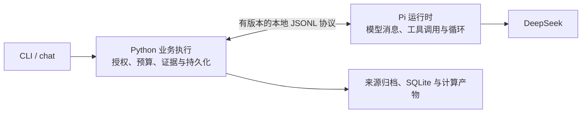

# 现有功能的架构改进方案

2026-10-09 初稿。2026-10-10 状态更新：用户已授权方案 B 的执行架构阶段，公共执行操作、结果投影、直接 handler、模型传输及 Pi 钩子已经落地，见 [实现说明](35-agent-execution-architecture.md)。用户随后分别确认 Python 分包与仅 Pi SDK 包装层 TypeScript 化，纳入本轮。下文的“当前情况”和基线数字保留评审时点语境；相关性上下文、计算到答案渲染、快照优化与 Harness 尚未实施。默认运行时、真实质量门槛和研究规则不变。

## 1. 建议与判断依据

推荐继续使用 **Python 研究核心 + Pi 通用执行循环**，重点整理二者之间的数据和控制边界。最值得投入的是执行规则统一、结构化工具结果、上下文中的事实保留，以及计算结果到最终文字的交接。

现在已经有不少值得保留的设计：正式研究与临时问答分开；原文可追溯；公司库可以从归档重建；SQL 在只读快照上运行；Session / Turn / Attempt 分开；重试不会刷新预算；最终引用需要实际回执。没有必要为了使用更多 SDK，把这些领域规则重新做一遍。

评审检查了当前源码、用户指定的 Pi 学习项目和本项目锁定的 Pi 0.83.0 实现，并参考 OpenAI Docs 的公开 app-server 协议。判断依据是职责和数据流；文件行数本身不构成重构理由。

本轮实际运行：默认路径 `./.venv/bin/python -m pytest -q` 为 **283 passed，4.89 秒**；Pi 路径 `WONDER_AGENT_RUNTIME=pi ./.venv/bin/python -m pytest -q` 为 **283 passed，9.33 秒**。均为离线测试，没有真实模型或 OpenD 调用。它们不证明原 30 题已答对，也不改变真实执行额度已用完的状态。

## 2. 三种整体选择

| 方案 | 做什么 | 好处 | 成本与局限 |
| --- | --- | --- | --- |
| A：局部整理 | 提取重复的预算、工具执行和报告保存函数，保留当前两条运行路径 | 改动较少，适合先降低维护负担 | 两套上下文和执行路径仍容易出现差异 |
| **B：明确混合架构，推荐** | Python 统一业务执行规则和数据契约；Pi 管模型协议、原生工具调用与循环；二者通过有版本的轻量协议连接 | 研究规则只有一份，能单独测试和替换运行时；同时复用 Pi | 要整理内部接口和兼容层，仍维护两种语言 |
| C：进一步使用 Pi AgentHarness | 在 Python 继续拥有授权、预算、Turn/Attempt 和持久化的前提下，评估让 Pi 承担更多消息组织与压缩 | 可以少写一部分通用会话代码 | Pi Session 与项目 Session/Turn 语义需要映射；摘要调用也要进入预算；跨进程适配未必比当前实现简单 |

推荐 B。它能直接解决已经看到的交接问题。C 值得做小范围原型，但不能因为 SDK 提供了某个类，就认定接入后更简单。

下面是 B 中开放问答部分的职责图；执行边界现已实施，后续优化分别验收：



B 中仍按现有约定保留旧运行时作为迁移兼容路径；真实质量门槛通过后才评估默认切换和删除范围，不在重构时提前宣布迁移成功。

## 3. 优先级一：让执行规则有一个明确负责人

### 当前情况

[agent.py](../src/wonder_stockresearch/agent.py) 同时包含公开入口、Session/Turn/Attempt 生命周期、旧循环、预算结算、报告与 Memo；[pi_agent.py](../src/wonder_stockresearch/interactive/pi/pi_agent.py) 再通过局部导入访问它的多个私有函数，同时负责模型事件、预算、工具缓存、修复和最终保存。

这不是完全重复两套业务，但运行时适配层知道的业务细节较多。以后修改一种失败处理，容易只改到其中一条路径。

另外，Turn 已保存 `_agent_runtime`，执行分支仍由当前环境变量选择；现有兼容检查只在启用 Pi 时拒绝旧 Turn。建议恢复执行时以该 Turn 固定的运行时为准，不能因换一个终端配置而改变旧问题的执行语义。

### 可选改法

- A：只提取两条路径共用的函数，保持调用方向基本不变。
- **B：把开始尝试、模型请求前预留、用量结算、工具授权执行、接受最终回答和结束尝试，做成明确的 Python 业务操作。** 旧循环与 Pi 都调用这些操作，适配层只翻译运行时消息。

不需要新增调度平台、依赖注入容器或通用工作流引擎。现有 `agent_runtime.py` 的状态迁移检查继续复用，新增部分也可以只是几个小模块和 Pydantic 数据模型。

对产品经理来说，这相当于明确：**Pi 决定下一步提出什么行动，Python 决定该行动能否执行，以及执行后如何记账。**

预算、授权和最终提交属于必须等待结果的操作；进度展示和 trace 是观察记录。协议里应区别两类消息，不能把预算提交当成可丢弃的通知。当前锁定版本的 Pi `Agent.subscribe` 会等待异步监听器，不能把学习材料里另一层 `session.subscribe` 的描述直接套过来。

验收重点：同样的工具请求在两条路径上受到同样的授权和预算约束；未知 usage、中断和重试不会免费重跑；改变环境变量不能偷偷改变既有 Turn 的运行时。

## 4. 优先级一：给工具结果一个共同的数据契约

### 当前情况

工具参数已经由 [tool_registry.py](../src/wonder_stockresearch/interactive/tool_registry.py) 统一校验；返回值主要还是不同形状的字典。模型投影需要在 [agent_memory.py](../src/wonder_stockresearch/interactive/agent_memory.py) 和 [pi_context.py](../src/wonder_stockresearch/interactive/pi/pi_context.py) 识别 `rows`、`records`、`result.sql`、`result.function` 等字段。

之前的大状态正文和分页问题已经有修复。下一步可以把这些经验变成通用契约，让新增或调整一个现有工具时不必再补多处特殊判断。

### 可选改法

- A：继续针对每个工具补裁剪规则，实施最快，但容易遗漏新结果形状。
- **B：统一返回外壳，内部数据仍按工具分型。** 外壳说明成功/错误、产物位置、证据、覆盖范围、是否完整和分页位置；数据对象保留具体工具的字段。

一个财务事实应把“值、期间、单位、倍率、币种、口径、来源定位”作为一组传递。不能数字留下了，说明数字含义的字段却被裁掉。

对已有归档和计算文件使用稳定产物 ID 引用，不要求把完整结果再复制到每条事件和每条消息。工具错误也应统一表达：是参数错误、查询为空、原始资料缺失，还是执行失败，以及是否可以纠正后继续。它们不能都被解释为“公司没有这项数据”。

小白可以理解为：**每张数据卡片自带标签，不能把“2024 年、人民币万元”的标签从数字上撕掉。**

验收重点：压缩结果仍保留完整事实标签和可用的续查位置；空查询与缺资料能区分；错误保留可恢复性；不同运行时对同一工具结果的解释一致。

## 5. 优先级一：统一上下文整理规则，保留与问题相关的工作结果

### 当前情况

项目已经区分原始资料、计算产物、可见消息、工作记录和模型投影，也已经按完整工具调用组裁剪。Pi 工作记录目前是最近操作的有界摘要；旧 Python 路径还有独立的 `agent_context.py` 和 Scratchpad 压缩逻辑。

这比把所有结果原样塞进模型好，但“最近发生”不一定等于“回答这道题最重要”。例如早些时候算出的三年均值，可能比最近一次列出来源更应该留下。

### 可选改法

- A：继续增加输入容量，能延后超限，但不解决反复携带无关资料的问题。
- **B：统一确定性的上下文整理规则。** 保留原问题、明确的用户补充、已取得的相关事实/计算产物 ID、尚未完成的部分、最后完整工具组与必要引用；原文与完整结果按需读取。
- C：加入 Pi 的模型摘要，进一步压缩较长历史，但会增加调用成本和摘要失真风险。

先做 B。优先把已有工具回执整理成可检查的工作记录，不记录模型隐藏推理，也不要求额外模型决定所有记忆内容。以后如使用 C，摘要只帮助定位，数字和引用仍从原产物恢复；摘要调用必须经过同一预算预留和 usage 结算。

业务内容的选择可以共用，发送给旧模型与 Pi 的消息编码分别保留。强行让两个模型协议使用完全相同的字符串，反而会丢掉 Pi 的原生工具配对信息。

小白可以理解为：**仓库里保留全部材料，桌上放当前问题需要的材料和办事进度；桌面大小只是其中一个参数。**

验收重点：同一问题在多轮查询和一次失败修复后，早先必要计算仍可定位；压缩不产生孤立工具结果；截断不能被模型误认为没有数据。

## 6. 优先级一：把“算出来”和“写出来”衔接起来

### 当前情况

[query_workspace.py](../src/wonder_stockresearch/interactive/query_workspace.py) 保存 SQL、函数结果、输入覆盖和哈希；最终 [InteractiveReport](../src/wonder_stockresearch/models.py) 的回答和 claim 仍主要是自由文本。引用回执能够证明模型读取过某处资料，不能证明文字准确解释了计算结果。

### 可选改法

- A：每次生成后再用模型审查全文。覆盖面较广，但增加成本，也不能保证发现全部语义错误。
- **B：让数字展示直接引用结构化事实或计算结果，Python 渲染数值、期间和单位，模型主要生成解释。** 计算产物保留输入事实、公式/代码、结果及必要的比较关系。

例如两个区间分别是 10–20 和 15–25，程序已经可以给出“重叠”。最终回答使用这个结果，不再让模型根据两个均值自行推断区间关系。这是说明机制的虚构例子，不是对某家公司数据的判断。

沿用已有 SQL 和受限函数能力，不为 30 道题分别写死工具。也不把固定报告的评分写入临时问答：可以共享事实与计算表示，正式报告流程继续独立。

这是从输出设计上减少出错机会，不只是再加一层校验。原始单位未知仍保持未知；公式是否适合业务问题、文字是否过度归因，仍需要质量评测，不能由模板证明。

验收重点：逐年数值不能错配年份；数字与工具产物一致；单位缺失不自动补百分号；结构化比较结果与数字展示一致；自由解释仍单独审阅。

## 7. 优先级二：按资料版本复用查询快照

### 当前情况

现有双库职责合理：`wonder.db` 管来源身份和业务状态，`company.db` 是可重建的事实投影，不建议为了“只有一个库”而合并。

但 [agent_company.query](../src/wonder_stockresearch/interactive/agent_company.py) 先取得所选来源的事实，再在 Python 排序、筛选和分页；`_prepare_sql_run` 每次 SQL 都生成一份完整隔离快照。这让窄查询承担了较多准备工作。

### 可选改法

- A：维持当前实现。简单，资料规模较小时可能已经足够快。
- **B：先测量准备时间，再按来源集合、原始哈希和解析器版本复用不可变快照；筛选和分页尽量在 SQLite 中完成。** 每次分析单独保存 SQL、函数和结果，引用同一份资料版本。

Turn 补取新来源后生成新快照版本；已经完成的分析继续指向旧版本。跨 Turn 可以复用相同的只读数据文件，不能复用另一个 Turn 的授权或证据回执。备份也必须按引用收录被使用的快照。

产品上的收益是减少重复准备资料造成的等待；实际收益需要测量，不能仅凭代码结构承诺加速。

## 8. 优先级二：拆开公共模型调用和具体写作规则

### 当前情况

[router.py](../src/wonder_stockresearch/router.py) 通过 `writer._traced_request`、`writer._api_key` 等私有函数调用模型，旧问答也借用 Writer 的请求能力；Pi 路径使用独立适配。这样“怎么请求模型”与“怎么写正式报告”有一定耦合。

[agent_policy.py](../src/wonder_stockresearch/interactive/agent_policy.py) 已经集中组装提示词，但基础约束、财务分析方法、错误恢复建议与输出格式混在一个较长的构造函数内。

### 可选改法

- **A：抽一个小型公共 Python 模型调用模块，统一配置、错误、usage 和 trace；Writer、Router、旧问答各自处理自己的输出。** Pi 保留 SDK 适配，公共结果含义一致即可。推荐先采用。
- B：所有模型调用都经过 pi-ai，Writer/Router 只调用其单次生成能力。这能统一传输，但也让目前独立的固定研究和分类步骤新增 Node 依赖，需要明确收益后再选择。

提示词可分为基础身份、不可变边界、方法 Skill、工具动态提示和输出格式；版本与哈希纳入执行记录。可编辑的方法文字可以放 Markdown，真实授权仍留在 Python，不能因为修改一句提示词就改变访问权限。

不需要把 Router 和 Writer 改成自主循环 Agent。对产品经理来说，分类、写作和开放问答使用同一种“模型请求服务”，但仍做不同的工作。

## 9. Pi 模块具体复用到什么程度

本项目实际锁定 `pi-ai` 和 `pi-agent-core` 0.83.0。该版本 `pi-agent-core` 已公开导出 `AgentHarness`、`Session`、compaction 与 truncate 等模块，不能仅依据旧版本印象判断这些能力只在 coding-agent 中。

| 能力 | 建议 | 原因 |
| --- | --- | --- |
| pi-ai 的模型协议、流式响应和原生工具消息 | 继续直接复用 | 已经接入，是通用基础能力 |
| pi-agent-core 的 Agent 循环、工具调度和相关钩子 | 继续直接复用 | 不需要再手写一套 Pi 循环 |
| compaction 的切点、阈值、usage 辅助函数 | 按需评估复用 | 与上下文管理有关，但当前项目不必引入会话树才能裁剪消息 |
| truncate 的字节/行边界处理 | 适合文本摘录 | 财务事实需要按完整数据对象裁剪，不能直接按文本切数字 |
| 自动模型摘要 | 后置评估 | 要验证数字、引用保真，并计入原预算；SDK token 估算也不是精确 tokenizer |
| AgentHarness / Session | 先比较适配成本 | Python 仍是授权、业务生命周期与持久化权威，不能再出现一套独立的事实源 |
| 通用 Skill 文件读取与格式化 | 参考实现，保留领域 Registry | 项目的 capability、工具白名单和冻结选择不是通用 Markdown loader 能替代的 |
| pi-coding-agent 的完整 CLI、资源发现与编程工具 | 当前不整包接入 | 学习项目主要使用这一层；其工作目录、全局资源、编程人设和文件/shell 工具与本项目边界不同 |

Python 版源码讲解用于理解概念，不视为已验证的 Python Pi SDK 运行依赖；实际接入以本项目安装的 JavaScript/TypeScript 包为准。

Codex 值得借鉴的是公开协议中的消息 schema、初始化、请求/响应与通知区分，以及 Thread/Turn/Item 的关系。这支持 B 的接口思路，不意味着项目需要 Codex 宿主、网络服务、多 Agent 或完整事件重放。[OpenAI Docs：Codex App Server](https://learn.chatgpt.com/docs/app-server)

## 10. 推荐实施顺序与完成条件

1. **执行边界与协议。** 抽出共用业务操作；固定 Turn 的运行时和策略；给 JSONL 控制消息定义 Pydantic schema、版本与错误类别。协议不兼容时在付费调用前拒绝。
2. **工具结果与上下文。** 统一结果外壳、事实对象和确定性工作记录；优先复用已有引用/产物，保留两种消息编码。
3. **计算到回答。** 数字与比较结果由产物生成展示；模型生成解释；离线覆盖“算对讲错”和单位/期间错配。
4. **有测量依据的整理。** 再做快照复用、查询下推、公共模型调用与提示词拆分，避免同时调整太多变量。

每一步都保持 CLI 行为、来源权限、正式报告冻结和 Memo 显式保存规则。必要测试验证数据/预算/状态等实际边界，不为每次拆文件增加重复测试。

真实模型复测是另一层验收：应固定资料快照、模型与问题，记录代码/提示词/工具版本，并把数据支持、计算、文字解释、引用、成本分别评分。结构整理和更大预算均不自动代表答案质量提高。本轮不启动真实复测，原额度也不自动延长。

参考材料：用户提供的 `pi_sdk_learn` 第 4–7 章及对应代码、`pi_source_dive` 第 2、6–10 章；本项目安装的 0.83.0 `pi-agent-core` 的 `types`、`Agent`、`AgentHarness`、`Session` 和 compaction 导出；[当前架构](33-current-architecture.md)、[Pi 运行时](30-pi-agent-runtime.md)、[可靠性修复](32-pi-agent-reliability.md)。学习项目仅作参考，不成为本项目依赖。

## 11. 补充：bash / write 是怎样处理的

用户继续询问整体代码能否简化、学习项目关闭 bash/write 的做法是否适用，以及是否应使用 `defineTool`。以下是源码核对结果和待实施建议。

学习材料的部分例子使用 `pi-coding-agent.createAgentSession`。该层 0.83.0 默认激活 read、bash、edit、write，可通过 `tools` 白名单、`excludeTools` 或 `noTools` 控制。因此，用它开发垂直助手时需要明确处理内置工具。

本项目使用 `pi-agent-core.Agent`，没有使用 coding-agent 的会话构造器。Core 的初始工具数组在未提供时为空；虽然包导出了编程工具的工厂函数，导出能力不等于自动实例化或授权。本项目只把 Python 生成的 `config.tools` 转为 Pi 工具传入，未创建通用 bash、write、edit、read 工具。

现有控制分为两层：

1. Python 根据 Registry、capability 默认工具及所选 Skill 生成可见目录，并保存 Turn 授权；Pi 仅拿到该目录。
2. 具体调用回到 Python 时再次检查获准名称、Pydantic 参数，以及对应服务中的公司、来源、网络权限和分析范围。

因此当前无需再写一份“关闭 bash/write”的配置。建议继续明确列出获准工具，执行前继续校验，提示词用于说明规则。

这里的“没有 write 工具”不表示文件系统没有写入。Python 仍会按既有业务流程在 `data/` 保存归档、SQL 快照、计算结果、执行状态和临时报告；模型没有指定任意文件路径和任意正文的通用写入入口。`finish`、`memo-save` 仍由用户通过业务命令调用，不属于开放 Agent 的工具。

`read_source` 也不是通用 `read(path)`：模型提供 source_id 和定位参数，程序决定读取哪一份已授权来源。`run_analysis_function` 不是 bash：它处理已取得的 SQL 行，经过语法白名单和受限子进程执行。应保持其有限能力，不把它描述为可以安全执行任意 Python 的通用沙箱。

## 12. 工具定义有没有用 defineTool

**没有调用 `pi-coding-agent.defineTool`；但 Pi 路径确实使用 Pi 原生工具执行机制。**

实际链路为：

```text
Pydantic 参数模型 + Python ToolDefinition
    → Registry 解析获准目录、生成 JSON Schema
    → Node 转成 { name, parameters, execute, ... } 的 Pi AgentTool
    → Pi 解析原生 tool call 并校验参数
    → execute 通过本地 JSONL 请求 Python
    → Python 再做授权/参数/领域检查并调用业务函数
    → 有界结果交回 Pi，循环继续
```

定义见 [tool_registry.py](../src/wonder_stockresearch/interactive/tool_registry.py)，执行见 [agent_tools.py](../src/wonder_stockresearch/interactive/agent_tools.py)，Node 包装见 [runner.mjs](../src/wonder_stockresearch/pi_runtime/runner.mjs)。项目现在登记 18 个工具，直接 ask 的兼容目录为 17 个；company_latest 可加入公司查询工具，Skill 路径按所选授权解析，并非每次展示全部工具。

核对用户提供的 0.83.0 coding-agent 发行包，`dist/core/extensions/types.js` 中实际实现为：

```javascript
export function defineTool(tool) {
    return tool;
}
```

配套类型声明说明它保留独立工具定义的 TypeScript 参数推导。它不是授权系统，不实现财务服务，也不负责隔离文件访问。在当前 JavaScript 包装层中增加这个调用，不能自动删除 Python Registry、参数模型或业务权限代码，反而会为一个类型辅助函数引入 coding-agent 依赖。

目前“一份 Pydantic 输入模型生成 schema，Python 执行业务，Pi 负责调度”的方向合理。Pi 的协议侧参数校验与 Python 的执行侧参数校验位于不同边界，仍应各自保留；避免手工再维护一份 TypeBox 参数定义。

## 13. 哪些函数应当更简洁

本轮 AST 核对：旧 `_execute_session_loop` 为 442 行，Pi `execute` 为 309 行（其中事件分支函数 197 行），`_execute_tool_impl` 为 131 行。这些行数用于定位阅读负担，不能直接推导应缩减多少代码。

最明确的整理点是工具分发：当前 Registry 的 `_HANDLERS` 为每个工具绑定闭包，但每个闭包又回到同一 `_execute_tool_impl`，再根据工具名执行长分支。可以让工具定义直接绑定相应的普通函数，去掉中间转接。每个 handler 按需读取资料，不在所有工具之前统一加载 run 和来源列表。

待实施的组织示意：

```text
统一执行入口
    → 检查 Turn 授权
    → Pydantic 校验参数
    → 根据工具定义调用明确的 handler(context, args)
    → 统一整理结果和回执
```

其中 context 只需一个小型数据对象，明确 root、ticker、session_id、turn_id 和固定范围；不需要容器、插件系统或服务定位器。工具名、描述、参数类型、适用能力与 handler 在一个显式登记点绑定；避免用两套注册再返回同一个大分支。

其他值得整理的实际职责：

- 把 Pi 事件转译与 Python 预算、工具执行、最终提交分开；对调用有意义的业务操作各有一个入口。
- 用一个小状态对象显式承载执行进度，减少大型闭包中多处 `nonlocal` 修改状态；事务和预算不因此放松。
- 按职责拆开 Writer 的请求、分组写作、审查和缓存；公共模型请求移到独立模块，Router 不再借用 Writer 私有函数。
- 结构化事实与工作记录的选择规则共用，旧协议和 Pi 的消息编码各自保留。
- 质量门槛通过后按兼容计划收敛运行时；长期维护两个完整实现会持续增加成本，当前不能提前删除旧路径。

这些改动中，一部分是应用自身的职责整理，Pi 不会自动代做。判断标准是减少重复规则、转接和隐藏依赖，而不是把所有函数压成更少行。

## 14. 更多自写实现能否交给 Pi

| 当前能力 | 可复用的 Pi 能力 | 建议 |
| --- | --- | --- |
| 模型协议、流式解析、原生工具调度 | pi-ai、Agent | 已在 Pi 路径复用，继续沿用 |
| 工具请求参数校验与错误工具消息 | `validateToolArguments` 及 Agent loop | 已由 Pi 执行协议侧处理；Python 仍保留执行侧校验 |
| 工具执行前后处理 | `beforeToolCall` / `afterToolCall` | 可让适配代码按钩子职责组织；领域授权和证据判断仍调用 Python |
| 上下文消息变换 | `transformContext` / `convertToLlm` | 复用调用边界；什么财务事实应该留下由项目决定，钩子本身不提供研究策略 |
| 纯文本摘录 | `truncateHead` / `truncateTail` | 可替换适合的自写文本裁剪；结构化财务对象另行投影 |
| 历史压缩 | `shouldCompact` / `findCutPoint` / `generateSummaryWithUsage` | 先验证适配收益；模型摘要计入预算并验证数字/引用保真 |
| 进程内运行的取消和等待 | `Agent.abort` / `waitForIdle` | Pi 运行部分可复用；Python 的遗留 Attempt 结算和子进程退出仍独立负责 |
| 通用 Skill 读取 | `loadSkills` 等 | 可参考，但当前调用位于 Python，另有 manifest、capability 与版本冻结，不宜再加载第二份目录 |
| 会话与更多通用执行管理 | `AgentHarness` / `Session` | 做小范围比较，避免两套会话事实源与重复持久化 |
| 来源授权、财务数据、计算、引用回执、正式报告 | 无可直接替换的领域实现 | 继续由 Python 管理，内部用普通函数简化 |

Pi 提供 usage 数据，不等于提供本项目跨 Attempt 的预算账本。现有“缺失 usage 不按零计费”的处理也不能仅凭 SDK 默认 usage 为 0 而删除。自动重试同样必须与累计预算和持久化语义一致，不能直接打开后宣称恢复行为等价。

本轮针对工具目录、原生 Pi 和受限查询的离线测试：`./.venv/bin/python -m pytest -q tests/test_tool_registry.py tests/test_pi_runtime.py tests/test_stage19_query_workspace.py` → **22 passed，1.51 秒**。另以实际 Registry 生成目录，确认不包含 bash、write、edit、通用 read、finish 或 memo-save。没有新增业务功能或修改实现，也没有真实模型/OpenD 调用。

## 15. `pi.on`、`session.subscribe` 与当前项目的具体对应

再次核对本项目锁定的 0.83.0，以及用户指定学习项目的事件章节和 coding-agent 发行源码。适合继续复用，但需要区分所在层级：

| API | 所在层级 | 是否等待异步处理 | 对本项目的意义 |
| --- | --- | --- | --- |
| `agent.subscribe` | pi-agent-core 的 `Agent` | 按订阅顺序等待，包含在本次运行完成条件中 | **当前已用**；适合消息保存、用量结算通知和运行进度转译 |
| `session.subscribe` | pi-coding-agent 的 `AgentSession` | 该版本直接调用 listener，不等待其 Promise | 适合进度观察；不能直接替换当前需要等待 Python 确认的保存与结算 |
| `pi.on` | coding-agent 扩展 API | 按具体事件等待处理，可返回相应修改或拦截结果 | 当前没有加载这套扩展系统；可以直接用 core 对应钩子实现现有需求 |
| `harness.on` | pi-agent-core 的 `AgentHarness` | 等待命名钩子处理 | 同一依赖里已有命名事件接口；若选择方案 C，再评估其会话适配成本 |

学习材料中“subscribe 不等待”的结论描述的是 coding-agent 的 `AgentSession`，不能推广到当前使用的 core `Agent`。`Agent.subscribe` 返回值不是工具拦截协议；需要拒绝调用或改变结果时，应使用专门的工具钩子。

当前 [runner.mjs](../src/wonder_stockresearch/pi_runtime/runner.mjs) 已经通过 `agent.subscribe(async ...)` 等待 Python 的 `model_end` 和 `message` 响应；用 `transformContext` 请求 Python 选择上下文，用 `followUp` 安排一次受控修复，用 provider `onPayload` 固定关闭 thinking 与并行工具调用。因此，现状是已经部分复用，需要把剩余职责组织得更清楚。

### 15.1 最适合接入或整理的现有职责

| 当前职责 | 建议使用的 Pi 接口 | 应怎样整理 |
| --- | --- | --- |
| CLI 进度、工具运行状态、通用 trace 生命周期 | `agent.subscribe` 的 `agent_start`、`tool_execution_start/end`、`message_end`、`agent_end` | 由一个轻量转译函数统一处理通用生命周期，减少在业务分支中散落的通知；Python 仍记录实际查询/计算及业务结果 |
| 工具执行前的运行限制 | `beforeToolCall` | 集中适配执行前检查，返回是否允许；规则由 Python 的统一执行入口判断，避免再维护一份 JavaScript 授权表 |
| 工具返回给模型的统一格式、提示与错误呈现 | `afterToolCall` | 可统一返回内容的包装；财务事实选择仍由 Python 投影函数决定，先保存实际结果及证据回执，再发送模型可见内容 |
| 每次请求的上下文选择与输入控制 | `transformContext` | 已接入，继续作为上下文选择边界；复用同一套 Python 事实选择规则，避免多个钩子各自改历史 |
| 模型可见消息保存、用量结算、非法 final 的一次修复 | 等待型 `agent.subscribe` + `followUp` | 已接入；把 Python 的保存、结算、final 校验拆成明确操作，Node 只转译协议 |
| 请求参数约束与响应状态观察 | `onPayload` / `onResponse` | 前者已用于 thinking/并行限制；后者只有 HTTP 状态和响应头，按需要记录允许的元数据，不能代替最终 usage 结算 |
| 完成一批工具后调整下一次运行条件 | `prepareNextTurnWithContext` | 有实际批次决策需求时再用；当前不必为了使用钩子新增另一套上下文管理 |
| 进程内停止与等待退出 | `Agent.abort` / `waitForIdle` | 可以复用 Pi 的停止机制，同时保留 Python Attempt 的预算、事务和子进程收尾 |

coding-agent 的 `_installAgentToolHooks` 明确把扩展 `tool_call` 接到 `agent.beforeToolCall`，把 `tool_result` 接到 `agent.afterToolCall`。所以当前采用 core 钩子有直接的源码依据，无需先接入 coding-agent 的完整扩展宿主。

不过，增加一个钩子再原样调用现在的大分支，并不会减少复杂度。实施时应把通用前后处理移到明确位置，让工具 handler 只执行其业务；跨 Python/Node 的 JSONL 请求响应仍然需要保留。也不建议为方便命名再自建一个 `pi.on` 事件框架。

### 15.2 三个必须保持的运行语义

1. **每次模型请求都要先拿到预算许可。** 目前 `streamFn` 发出 `model_start`，Python 先预留预算，再开始网络请求；assistant `message_end` 后等待 Python 结算。`agent_start` 每次运行只发一次，`onResponse` 又早于响应正文读取，都不能替代逐次预算管理。缺失 usage 仍不能按零计费。
2. **工具限制与结果提交需要明确的失败语义。** `beforeToolCall` 返回 `block` 会产生错误工具结果，不等于终止整个问题；原有必须停止 Turn 的规则仍需由 Python 明确执行。`afterToolCall` 可以改变返回给模型的内容，但不能以裁剪后的文本反推证据，真实结果与回执要先确认。该版本会将工具后钩子的异常转成错误工具结果，循环可能继续，所以不能把必须成功的证据提交仅放在这个钩子里；未知工具和部分参数校验失败也不会经过正常执行后的钩子。
3. **Pi 的 turn 与本项目 Turn 含义不同。** 一次用户问题可能有多次“模型决定 → 工具处理”，对应多次 Pi `turn_end`；不能每次都把 Python Turn 标为完成。`agent_end` 也只表示循环结束，最终成功仍须经 Python 的 final、引用及持久化校验，更不能触发正式报告 `finish`。

通用事件不携带未经筛选的隐藏推理、完整工具结果或响应头进入日志。`tool_execution_start` 在工具检查之前也会发出，表示开始处理一次调用请求，不保证业务函数已经执行；审计实际执行应继续依据 Python 业务 span。

建议实施顺序：先拆清 Python 预算/工具/最终提交操作，再统一原生事件的进度与 trace 转译，随后在确实减少重复代码的位置接入 `beforeToolCall` / `afterToolCall`。保持当前 `Agent` 即可推进；`AgentHarness.on` 纳入方案 C 的比较，不仅为一个更顺手的事件名更换会话管理。

本次运行一个纯离线 SDK 探针，确认六项行为：异步消息监听完成后才执行工具、工具消息监听完成后才进行下一次模型决定、`agent_end` 监听被等待、前后钩子按序且结果改写生效、执行前钩子能阻止工具、一次 prompt 可有两次 Pi `turn_end`。全部通过，真实模型请求为 0。没有修改业务实现或重新运行全量回归；此前 30 题的质量结论与真实额度不变。
