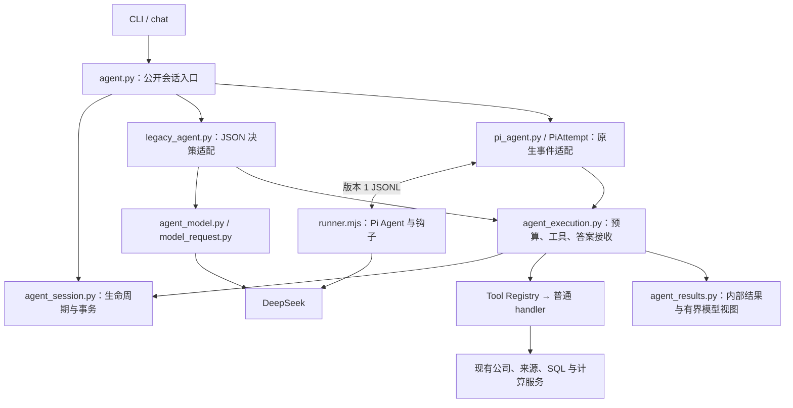

# 混合架构 B：执行边界、Pi 钩子与公共模型请求

2026-10-10。本章对应已授权的执行架构整理阶段。固定研究方法、CLI JSON、报告冻结和显式 Memo 保存规则保持原有含义；默认仍是 legacy，Pi 继续显式预览，thinking 关闭。本阶段没有新增真实模型或 OpenD 调用。

## 1. 本阶段解决什么

上一章比较了架构方案。本阶段落地其中的执行边界：以前修改预算、工具错误或答案保存，需要同时理解 Python 大循环和 Pi 事件分支；现在两种运行时调用同一组 Python 业务操作。

可以把它理解为：Pi 负责安排下一步，Python 负责查权限、执行研究工作和记账。换一种安排工作的方式，不应该换一套权限和账本。

## 2. 实际数据流



Router、Writer 和公司名称识别也复用 `model_request.py` 的 Python 请求实现；它们仍是原有受控组件，不进入 Pi 的自主循环。

## 3. 从一次输入到输出读代码

| 实际文件与入口 | 职责 |
| --- | --- |
| [agent.py](../src/wonder_stockresearch/agent.py)：`ask` / `respond` / `retry` / `followup` | 对外会话入口、授权快照、选择冻结的运行时、Memo；旧私有函数名保留必要兼容别名 |
| [agent_session.py](../src/wonder_stockresearch/interactive/agent_session.py)：`start_attempt` / `record_attempt_progress` / `finish_attempt_and_turn` | Session/Turn/Attempt 业务操作、引用校验、最终事务和异常收尾 |
| [agent_execution.py](../src/wonder_stockresearch/interactive/agent_execution.py)：`AttemptBudget` / `prepare_tool` / `execute_tool` / `accept_answer` | 两种运行时共用的预算、工具重复检测、成功缓存、错误分类、回执与答案接收 |
| [legacy_agent.py](../src/wonder_stockresearch/interactive/legacy_agent.py)：`execute` | 保留旧 JSON 决策和上下文策略，调用公共执行操作 |
| [pi_agent.py](../src/wonder_stockresearch/interactive/pi/pi_agent.py)：`execute` | 准备 Pi 历史、配置与本次适配状态，启动 bridge，结束后交给公共答案接收 |
| [pi_attempt.py](../src/wonder_stockresearch/interactive/pi/pi_attempt.py)：`PiAttempt.handle` 及命名事件方法 | 翻译上下文、模型用量、工具前检、工具结果、消息与完成事件；不反向引用 `agent.py` 私有实现 |
| [pi_protocol.py](../src/wonder_stockresearch/interactive/pi/pi_protocol.py) / [pi_bridge.py](../src/wonder_stockresearch/interactive/pi/pi_bridge.py) | 严格协议契约、版本握手、请求 ID、受控进程通信与清理 |
| [tool_contracts.py](../src/wonder_stockresearch/interactive/tool_contracts.py) / [tool_registry.py](../src/wonder_stockresearch/interactive/tool_registry.py) / [agent_tools.py](../src/wonder_stockresearch/interactive/agent_tools.py) | 一份 Pydantic 参数定义、显式工具目录、直接绑定普通 handler、归属检查和按需读取 |
| [agent_results.py](../src/wonder_stockresearch/interactive/agent_results.py)：`ToolOutcome` / `ToolFailure` / `model_projection` | 完整内部结果与有界模型文本分开，成功和可恢复错误有共同契约 |
| [model_request.py](../src/wonder_stockresearch/model_request.py)：`request_deepseek` / `traced_request` | 公共配置、一次 HTTP 请求、可见文本与严格用量摘要；不拥有调用次数和业务预算 |

过程如下：

1. 新问题创建 Turn 时保存 `_agent_runtime`。同一 Turn 的恢复读这个快照；新 follow-up 创建新 Turn，才读取当前环境配置。没有该字段的旧 Turn 按 legacy 处理；未知或损坏的运行时在开始 Attempt 前拒绝。
2. `AttemptBudget.reserve()` 先把本次最坏预留持久化，再允许模型请求。只有确认是非负整数的实际用量才能结算，布尔值不算整数。用量未知或进程硬中断保留预留，重试不刷新额度。
3. 模型提出工具调用时，公共执行层检查获准工具与重复请求；Registry 校验参数、Turn 归属，再直接调用对应普通函数。读取 Memo 的 handler 不会为了统一入口先加载全部来源。
4. 成功工具的完整结果先用于回执、缓存和产物记录，再生成有界模型视图。`ToolOutcome` 是内部外壳，外部报告 JSON 和模型既有工具 payload 没有因此整体套上新格式。
5. 模型最终文本经结构与引用检查，由 `accept_answer()` 调用同一事务保存临时报告、记忆和成功状态。保存临时报告不会执行正式研究 `finish`，也不会自动保存 Memo。

## 4. 哪些部分真正复用了 Pi

直接调用 SDK 的源码是 [runner.ts](../src/wonder_stockresearch/pi_runtime/src/runner.ts)，构建生成 [runner.mjs](../src/wonder_stockresearch/pi_runtime/runner.mjs) 供 Python 启动。Python 通过本地协议配合这些调用；Python 文件本身没有导入 JavaScript SDK。

| Pi API 或钩子 | 当前接线 | Python 配合操作 |
| --- | --- | --- |
| `createModels` + `deepseekProvider` / `streamSimple` | 模型配置、SSE 与原生工具消息 | `begin_model` 请求前预算许可；`end_model` 用量结算 |
| `new Agent` / `agent.prompt` | 原生模型与工具循环、顺序执行 | 两种运行时共用的执行规则 |
| `beforeToolCall` | 请求 `tool_check`，等待许可 | `check_tool` → `prepare_tool`；执行时仍校验参数与归属 |
| 原生 `AgentTool.execute` | 请求 `tool` | `run_tool` → 公共 `execute_tool` → Python handler |
| `afterToolCall` | 把 Python 已确认的有界结果转换为 Pi content/details/isError | 不在此钩子中提交账本或证据 |
| `transformContext` | 请求 `context` | 按完整调用组投影，添加当前 Turn 工作记录；两种消息编码各自保留 |
| `agent.subscribe` | 等待 assistant/tool 消息与安全生命周期事件处理 | 保存可见消息、结算用量、显示进度 |
| `agent.followUp` | 最终结构或引用失败后添加一次修复提示 | 紧凑引用展开和校验；修复仍计费且禁止工具 |

没有引入 coding-agent 的 `pi.on` 或 `AgentSession.subscribe`。当前 core 已提供本项目需要的钩子；该锁定版本的 core `Agent.subscribe` 会等待异步回调，coding-agent 的 Session 监听行为不能直接套用。

工具由 Python 的 Pydantic 定义生成 JSON Schema，Node 包装成 Pi 原生 `AgentTool`。没有调用 `defineTool`，也没有创建 bash/write/edit 等通用工具。工具协议校验复用 Pi，业务权限仍由 Python 在执行边界检查。

## 5. 为什么错误不能全部交给钩子

Pi 前后钩子的异常可能被整理成普通工具错误，随后继续循环。查询语法错误可以给模型纠正机会；授权失败、预算失败或证据提交失败则必须停止。

因此 Python 业务回调遇到致命错误时，bridge 原样抛出并清理 Node 进程，不把它变成可忽略的 `ok:false` 工具回复。只有允许纠正的错误返回受控 `ToolFailure`，由后钩子标记 `isError`。

协议初始化、每条请求与回复都有版本；Node 先握手再运行，Python 校验单调递增的请求 ID、已知事件和有限 JSON 值。协议只允许可见文本/工具消息，不允许隐藏推理和供应商诊断。Node 的 `agent_end` / `turn_end` 不是项目成功提交信号；必须有有效 final、settled 和 Python 最终事务。

## 6. 最小可运行的离线检查

在项目根目录，使用已有开发环境：

```sh
./.venv/bin/python -m pytest -q tests/test_architecture_runtime.py tests/test_pi_protocol.py
./.venv/bin/python -m pytest -q
WONDER_AGENT_RUNTIME=pi ./.venv/bin/python -m pytest -q
./.venv/bin/ruff check src tests scripts
```

分包与 TypeScript 构建完成后的全量实际结果：默认 **368 passed（6.82 秒）**；Pi 配置 **368 passed（11.07 秒）**。新增用例覆盖冻结运行时、等待/恢复、两种工具错误语义、协议握手与错误退出、未知/非法用量、按需读取、投影和公共传输。真实 Pi SDK 测试使用脚本模型或阻断网络的 fetch 替换，结果写入临时测试目录。

这些检查证明执行边界符合契约，不证明真实 30 题已经答对。累计真实额度仍是 40/40；历史质量结论保留，真实改善待另行复测。

## 7. 小练习

阅读 `test_resume_uses_original_runtime_and_followup_uses_new_selection`：它先让问题等待用户，再切换环境变量，恢复原问题并追问。

尝试把第二个环境选择改成与第一个相同。预期仍能完成，并保持原 Turn 的累计用量；新问题才会有独立 Turn。测试使用虚构回答，不需要 API Key，也不会写项目主库。

## 8. 已知限制与后续

本阶段统一了结果投影和执行规则，仍保留两种上下文历史选择策略；没有实现按问题相关性统一选择工作记录。计算产物到最终数字/期间/单位的结构化渲染、查询快照复用及查询下推仍是后续独立阶段。

文件拆分让职责更明确，不能把新增契约和边界检查的行数视作性能收益。下一阶段的选择见 [架构方案](34-architecture-options.md)。

## 9. 用户追加确认的目录分包

用户分别确认了 Python 分包和 Pi 包装层 TypeScript 化。Python 的实际结构为：

```text
src/wonder_stockresearch/
├── cli.py / chat.py / router.py / agent.py   公开入口与分派
├── models.py / storage.py                   共同契约和持久化
├── financial_calculations.py                共同财务输入、Decimal 与可信计算
├── model_request.py                         共同 Python 模型传输
├── company_data.py / sources.py 等          共同数据与来源服务
├── fixed/
│   ├── research.py / writer.py
│   └── fixed_quality.py / reports.py / questions.py
├── interactive/
│   ├── agent_session.py / agent_execution.py / agent_runtime.py
│   ├── agent_tools.py / tool_contracts.py / tool_registry.py
│   ├── agent_context.py / agent_results.py / agent_memory.py
│   ├── agent_model.py / agent_policy.py / legacy_agent.py
│   ├── agent_company.py / agent_data.py / agent_errors.py
│   ├── query_workspace.py / analysis_workspace.py
│   └── pi/
│       ├── pi_agent.py / pi_attempt.py / pi_bridge.py
│       └── pi_protocol.py / pi_context.py / pi_evidence.py
└── pi_runtime/                              独立 Node 包，供 Python 启动
```

移动了 28 个内部模块，更新 import、测试、脚本和源码链接；不为每个旧内部路径增加转接文件。`agent.py` 是真实公开入口，仍留在原位置。SQLite、业务 data 路径、命令名和模型提示未因分包改变。

共用计算提取至 [financial_calculations.py](../src/wonder_stockresearch/financial_calculations.py)：固定 Writer 和两个问答工作区直接调用它。计算版本 `fixed-calculations-v3`、公式、期间/币种匹配与输入引用保持原值；它不依赖固定流程、交互 Agent 或数据库。`fixed_quality` 的原公开计算 API 以别名继续可用，实际实现只有一份。

目录表示业务所有权，而不是权限沙箱。共同预算和证据操作属于 `interactive`，不能仅因 Pi 调用它们就放入 `interactive/pi`。原有固定报告内部的局部导入仍用于避免依赖环；本次不通过搬目录宣称所有依赖环消失。

## 10. 为什么只有 Pi 包装层改 TypeScript

本次改的是原来的单个 `runner.mjs` 包装文件。现在 [src/runner.ts](../src/wonder_stockresearch/pi_runtime/src/runner.ts) 使用 SDK 的 `AgentEvent`、`AgentMessage`、`AgentTool`、`StreamFn`、`AssistantMessage` 等类型，编译器检查工具前后钩子、消息分支和模型流接口。RPC 采用按事件区分的请求/回复类型；Python Pydantic 仍负责运行时校验和工具参数 schema，TS 不另外定义一套财务参数规则。

[tsconfig.json](../src/wonder_stockresearch/pi_runtime/tsconfig.json) 开启 strict、索引访问/未使用变量等检查；项目锁定开发依赖 `typescript 7.0.2`、`@types/node 22.20.5`，Pi 运行依赖仍是原来的 0.83.0。不是使用全局编译器，也不从学习项目加载模块。

开发时在项目根目录执行：

```sh
cd src/wonder_stockresearch/pi_runtime
npm ci --ignore-scripts --no-audit --no-fund
npm run typecheck
npm run build
npm run check:generated
```

三项检查本轮均实际通过。`build` 先编译到忽略的 `build/`，再用 [构建脚本](../src/wonder_stockresearch/pi_runtime/scripts/build.mjs) 写出同目录 `runner.mjs`；`check:generated` 比较生成内容，防止只改 TS 却运行旧 JS。不要直接编辑生成文件。

运行发布包只需 Node 与生产依赖，可 `npm ci --omit=dev --ignore-scripts --no-audit --no-fund`；Python 仍启动随包附带的 JS，不在每次 ask 时编译。安装包包含 TS 源码、配置、构建脚本和 JS，不包含 node_modules 或中间 build 目录。

类型检查能提前发现 SDK 接口误用，不能证明模型回答正确，也不能代替执行时的授权、预算和证据检查。Python 核心与固定研究继续使用原技术栈。
